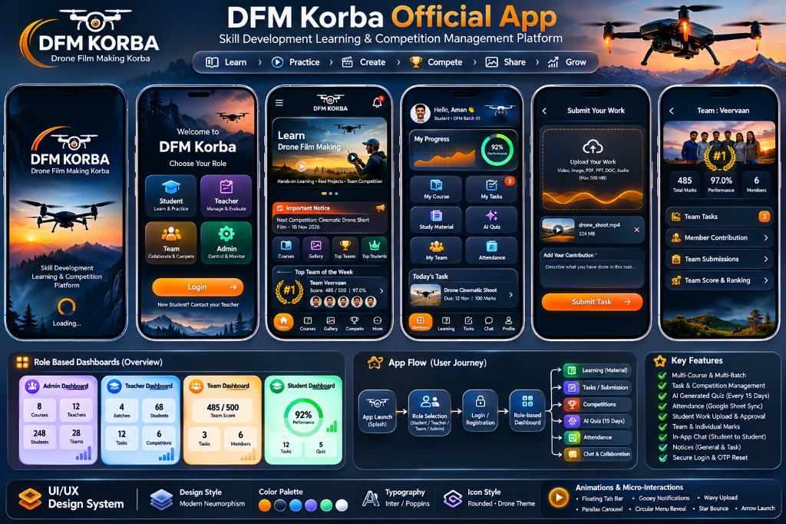

# DFM Korba Official Mobile Application
**Skill Development Learning & Competition Management Platform**


[](https://flutter.dev)
[](https://dart.dev)
[](https://developers.google.com/apps-script)
[-34A853?logo=googlesheets)](https://www.google.com/sheets/about/)
[](https://www.google.com/drive/)
[](https://ai.google.dev/)
[](#)

---

## 📌 Project Overview
The **DFM Korba Official App** is a production-grade, cross-platform mobile application engineered for Skill Development Learning and Competition Management. While tailored primarily for **Drone Film Making (DFM)**, it features a scalable multi-course architecture supporting courses such as Mobile Repairing, Front Office, and upcoming vocational tracks.

### Key Policies & Objectives:
- **Free for Students**: Learning resources, quizzes, and competitions are free for registered students.
- **Strict No-Certificate Policy**: The platform does **NOT** issue certificates or contain paid certification modules. Skill mastery, hands-on tasks, attendance, and competitions are the primary objectives.
- **Clean Architecture**: Built with Flutter (Dart) and a serverless Google Apps Script + Google Sheets (32 normalized tables) + Google Drive backend.
- **Modern Neumorphism**: Custom aviation dark-mode visual system with 10 fluid micro-interactions.

---

## 📱 Mobile Application Previews & Architecture
Refer to the UI/UX specification and architectural journey map:


### Core User Roles
1. **Public Visitor**: Explores general notices, #1 top team, top 5 student leaderboard, approved student portfolio gallery, and course catalog without login.
2. **Student**: Accesses learning materials (PDF/Video/DOCX/PPT), submits practical video work, views teacher feedback, takes fortnightly AI quizzes, tracks attendance, and collaborates via peer/team chat.
3. **Teacher**: Manages batches, creates teams, authors practical tasks & competitions, evaluates submissions with dual marks (team vs. individual), marks attendance matching official Student IDs, submits daily company reviews, and generates AI quizzes.
4. **Admin**: Global dashboard, course creation, teacher assignment & permissions, student registration with 1-click WhatsApp onboarding, notices authoring, public gallery curation, and audit logs.
5. **Team Portal**: Dedicated squad login using unique Team ID and password; manages group tasks, uploads team productions, and attributes member roles.

---

## 🗂️ Project Directory Structure

```
dfm_korba_official/
├── .github/
│   └── workflows/
│       ├── build_apk.yml              # CI/CD: Automated Android APK build & release
│       └── analyze_and_test.yml       # CI/CD: Static analysis & test runner
├── assets/
│   ├── images/                        # Logo, branding banners, and UI references
│   │   ├── dfm_korba_logo.jpg
│   │   └── dfm_korba_ui_spec.jpg
│   ├── icons/                         # Drone & aviation custom icons
│   └── seed_data/                     # Development seed payloads
├── backend/                           # Google Apps Script Serverless Backend
│   ├── Code.gs                        # Master Action Dispatcher & CORS Router
│   ├── AuthService.gs                 # Password Hashing, Sessions & Rate Limiting
│   ├── DatabaseService.gs             # 32 Normalized Google Sheets Operations
│   ├── TaskSubmissionService.gs       # Drive Media Upload & Dual Marks Logic
│   ├── AttendanceService.gs           # Student ID Matching & Daily Review Sync
│   ├── QuizService.gs                 # Gemini AI Quiz Generation & Auto-Grading
│   ├── ChatService.gs                 # Scoped Messaging & Moderation Engine
│   ├── ReportingService.gs            # Real-Time Analytics & Leaderboard Math
│   ├── SetupDatabase.gs               # One-Click Google Sheets Initializer
│   └── appsscript.json                # Google Apps Script Manifest & Scopes
├── documentation/                     # Comprehensive Engineering Specifications
│   ├── PRD.md                         # Product Requirements Document
│   ├── TRD.md                         # Technical Requirements Document
│   ├── APP_FLOW.md                    # App Flow & State Machine Journeys
│   ├── UI_UX_GUIDE.md                 # Neumorphic Design Tokens & 10 Animations
│   ├── DATABASE_SCHEMA.md             # Complete 32 Tables Google Sheets Model
│   ├── API_DOCUMENTATION.md           # Endpoints, Payloads & Response Schemas
│   ├── SECURITY.md                    # Threat Model, Salts & Session Controls
│   ├── DEPLOYMENT.md                  # Deployment Guide for Backend & Mobile
│   ├── TESTING.md                     # Quality Assurance, Edge Cases & RTM
│   └── CHANGELOG.md                   # Release History
├── mobile_app/                        # Complete Cross-Platform Flutter Codebase
│   ├── android/                       # Android Project Configuration & Gradle
│   ├── ios/                           # iOS Project Configuration & Runner
│   ├── lib/                           # Clean Architecture Dart Source Code
│   │   ├── core/                      # Constants, Neumorphic Theme, Animations, Network
│   │   ├── data/                      # Models, Data Sources & Repositories
│   │   └── presentation/              # Providers, Screens (5 Roles) & Widgets
│   ├── pubspec.yaml                   # Flutter Dependencies & Asset Mappings
│   └── analysis_options.yaml          # Strict Linter Configuration
└── tests/                             # Unit, Widget & Integration Tests
```

---

## 🚀 Quick Start Guide

### 1. Google Sheets & Apps Script Setup
1. Create a Google Drive folder: `DFM_KORBA_APP_STORAGE`
2. Create a Google Sheet: `DFM_KORBA_DATABASE`
3. Navigate to **Extensions > Apps Script** and paste files from `backend/`.
4. Run `initializeAllDatabaseSheets` in `SetupDatabase.gs` to construct all 32 sheets with sample seed data.
5. In **Project Settings > Script Properties**, set:
   - `STORAGE_ROOT_FOLDER_ID`: `[Your Google Drive Folder ID]`
   - `GEMINI_API_KEY`: `[Your Google Gemini API Key]`
6. Deploy as **Web App** (Execute as: `Me`, Access: `Anyone`). Copy the Web App URL.

### 2. Mobile App Setup
1. Edit `mobile_app/lib/core/constants/api_endpoints.dart` and insert your Web App URL.
2. Run Flutter:
   ```bash
   cd mobile_app
   flutter pub get
   flutter run
   ```

### 3. Automated APK Generation
Every commit pushed to the repository automatically triggers the GitHub Actions workflow to build release Android APKs (`armeabi-v7a`, `arm64-v8a`, `universal`).

---

## 🔒 Security Architecture
- **Salted SHA-256**: All passwords hashed with unique user salts; no plaintext passwords stored.
- **Login Rate Limiter**: 3 consecutive failed logins triggers a 30-minute account lockout.
- **Forced Password Rotation**: Temporary passwords assigned by teachers/admins must be changed upon first login.
- **Zero Exposed Keys**: All Google Drive and Gemini AI credentials remain strictly server-side.

---
*Developed for DFM Korba Skill Development Center.*
