# APPLICATION FLOW & USER JOURNEYS
## DFM Korba Official Mobile Application

This document maps out the state machines, screen transitions, and detailed end-to-end user journeys for the DFM Korba Official App, grounded directly in the reference architectural specification.

---

### High-Level Architectural Flowchart

```mermaid
flowchart TD
    Splash["1. App Launch / Splash Screen (Drone Theme)"] --> RoleSelect["2. Role Selection (Student / Teacher / Team / Admin)"]
    RoleSelect -->|Visitor / Browse| PublicHome["3. Public Home Screen (No Login Required)"]
    RoleSelect -->|Student| StudentLogin["4. Student Login (Mobile + Password)"]
    RoleSelect -->|Teacher| TeacherLogin["5. Teacher Login (Mobile + Password)"]
    RoleSelect -->|Admin| AdminLogin["6. Admin Login (Username/Mobile + Password)"]
    RoleSelect -->|Team Squad| TeamLogin["7. Team Login (Team ID + Password)"]

    PublicHome --> PublicCourses["Course Catalog"]
    PublicHome --> PublicGallery["Approved Work Gallery"]
    PublicHome --> PublicLeaderboard["Top Teams & Top Students"]
    PublicHome --> PublicAbout["About Skill Center"]

    StudentLogin -->|First Login / Temp Password| ForcePassChange["Change Temp Password Screen"]
    StudentLogin -->|Authenticated| StudentDash["Student Dashboard"]
    
    TeacherLogin -->|Authenticated| TeacherDash["Teacher Dashboard"]
    AdminLogin -->|Authenticated| AdminDash["Admin Dashboard"]
    TeamLogin -->|Authenticated| TeamDash["Team Portal Dashboard"]

    subgraph Student Journey
        StudentDash --> LearningHub["Learning Materials (PDF, Video, DOCX)"]
        StudentDash --> TasksList["Assigned Tasks (Individual & Team)"]
        TasksList --> SubmitWork["Submit Work (Upload MP4/Photos/Docs)"]
        StudentDash --> QuizHub["Bi-Weekly AI Quizzes"]
        QuizHub --> TakeQuiz["Take Timed Quiz -> Auto Results"]
        StudentDash --> AttendanceHistory["Personal Attendance History"]
        StudentDash --> ChatHub["Student Chat (P2P, Team, Batch)"]
        StudentDash --> StudentProfile["Profile & Overall Ranking"]
    end

    subgraph Teacher Journey
        TeacherDash --> BatchMgmt["Batch & Student Roster"]
        TeacherDash --> TeamMgmt["Team Creation & Student Assignment"]
        TeacherDash --> TaskCreation["Task & Competition Authoring"]
        TeacherDash --> ReviewQueue["Review Submissions & Marks Awarding"]
        TeacherDash --> MarkAttendance["Mark Batch Attendance (Sync Sheet)"]
        TeacherDash --> DailyReviewForm["Submit Daily Company Review"]
        TeacherDash --> AIQuizGen["AI Quiz Generator & Approvals"]
        TeacherDash --> Reports["Batch Analytics & Progress Reports"]
    end

    subgraph Admin Journey
        AdminDash --> CourseMgmt["Create & Manage Skill Courses"]
        AdminDash --> TeacherMgmt["Add Teachers & Assign Scopes"]
        AdminDash --> StudentReg["Register Student + WhatsApp Onboard"]
        AdminDash --> NoticeMgmt["Publish General & Task Notices"]
        AdminDash --> GalleryModeration["Curate Public Gallery"]
        AdminDash --> AuditLogs["Activity Logs & Security"]
    end

    subgraph Team Journey
        TeamDash --> TeamTasks["View Squad Assignments"]
        TeamDash --> TeamSubmit["Upload Group Work + Member Credits"]
        TeamDash --> TeamScores["View Pure Team Marks & Rank"]
    end
```

---

### Detailed Journey Specifications

#### Journey 1: Visitor & Public Experience
1. **Entry**: Any user can launch the app and tap "Explore Public Content" from the role selection screen or bottom navigation.
2. **Public Home Feed**:
   - Drone cinematic header banner with tagline *"Learn > Practice > Create > Compete > Share > Grow"*.
   - **Important Notice Ticker**: Flashing general announcements (e.g. *"Next Competition: Cinematic Drone Short Film - 18 Nov 2026"*).
   - **Top Team of the Week**: Spotlights Team *Veervaan* with member photos, team score (e.g. `485 / 500`), and performance percentage (`97.0%`).
   - **Top 5 Students**: Cards showing student photo, name, course, rank, and score.
   - **Student Work Gallery**: Filterable stream of approved drone clips and photo reels with full-screen playback.
   - **Course Directory**: Syllabus and outcomes for Drone Film Making, Mobile Repairing, Front Office, etc.

#### Journey 2: Student Registration & WhatsApp Onboarding
1. **Action by Teacher / Admin**:
   - Opens "Register Student" screen.
   - Enters: Full Name, 10-digit Mobile Number, Email Address, Course (e.g. `CRS_DRONE`), Batch (`BTC_DFM_01`), and optional initial Team assignment (`TM_VEERVAAN`).
2. **Backend Processing**:
   - Generates unique Student ID (`STU_DFM_042`).
   - Generates random secure temporary password (e.g. `Dfm#Rohan78`).
   - Stores salted SHA-256 hash in `Users` sheet with `is_temp_password = TRUE`.
   - Pre-populates a formatted WhatsApp invitation text.
3. **Onboarding Hand-off**:
   - Administrator taps **"Send via WhatsApp"** button.
   - The device opens the official WhatsApp chat pre-filled with:
     > *"Namaste [Student Name]! Welcome to DFM Korba Skill Center. Your Student ID: [ID] | Login: [Mobile] | Temp Password: [TempPass]. Please install the app and log in."*
   - Admin also has a **"Copy Credentials"** button for clipboard backup.

#### Journey 3: Student First Login & Forced Password Change
1. **Login**: Student enters registered Mobile Number and temporary password.
2. **State Interceptor**: Backend verifies credentials and detects `is_temp_password == TRUE`.
3. **Redirection**: Student is immediately routed to `ForcePasswordChangeScreen`.
4. **Validation Rules**:
   - Minimum 8 characters.
   - At least 1 uppercase letter, 1 number, and 1 special character.
   - Cannot match the temporary password.
5. **Confirmation**: On success, `is_temp_password` is set to `FALSE`, a new session token is issued, and student enters their personal dashboard.

#### Journey 4: Task Execution & Work Submission (Wavy Slider Animation)
1. **Discovery**: Student opens `Tasks` tab; views cards grouped by *Today's Task*, *Pending*, and *Submitted*.
2. **Open Task**: Taps on *"Drone Cinematic Sunset Shoot - Due: 12 Nov | 100 Marks"*.
3. **Brief & Rubric**: Reads flight safety guidelines, shot checklist (Orbit, Reveal, Fly-over), and allowed formats (`MP4`, `MOV`, max `500 MB`).
4. **Upload Trigger**: Taps the Neumorphic Cloud Upload container.
5. **File Selection**: Uses native file picker to select `drone_shoot.mp4` (e.g. 324 MB).
6. **Wavy Track Animation**: An animated sinusoidal soundwave/progress track simulates compression check and active upload state.
7. **Member Contribution Notes**: Student writes notes: *"Aman: Pilot in Command; Rahul: Camera Gimbal Operator; Priya: Post-production Color Grading"*.
8. **Submission Confirmation**: Taps orange CTA **"Submit Task ->"** with arrow launch micro-interaction. Status transitions to `Pending Review`.

#### Journey 5: Teacher Evaluation & Dual Marks Recording
1. **Teacher Alert**: Instructor sees a notification badge on "Submissions Review Queue".
2. **Playback & Review**: Opens the submission, streams the video directly or opens in full screen.
3. **Evaluation Modal**:
   - **Award Team Score**: Sets collective team points (e.g. `95 / 100`) recorded into `TeamMarks` table.
   - **Award Individual Scores**: Enters specific marks for each contributing student recorded into `IndividualMarks` table.
   - **Feedback**: Enters constructive notes (*"Smooth gimbal pitch on the sunset reveal; watch propeller shadows in frame"*).
   - **Gallery Toggle**: Switches ON *"Publish to Public Showcase Gallery"*.
4. **Commitment**: The record updates atomically in Google Sheets; student receives an instant in-app notification.

#### Journey 6: Daily Attendance & Company Review Synchronization
1. **Attendance Marking**:
   - Teacher selects Date and Batch.
   - App renders the student roster pulling verified Student IDs from the Google Sheet.
   - Quick toggles: "Mark All Present", followed by single taps to mark specific students "Absent".
   - Taps "Save Attendance": Writes records directly to the project owner's attendance sheet structure.
2. **Daily Company Review**:
   - At end-of-day, teacher fills out the standard 8-field review form:
     1. Date
     2. Course & Batch
     3. Activities completed (theory + simulator + flight time)
     4. Student progress observations
     5. Challenges encountered (battery degradation, weather constraints)
     6. Output deliverables completed
     7. Teacher remarks & signature
   - Submits directly into the designated `DailyReviews` Google Sheet.

#### Journey 7: AI Quiz Generation & Fortnightly Exam Lifecycle
1. **Teacher Trigger**: Every 15 days, teacher opens "AI Quiz Generator".
2. **Configuration**: Selects Course (`Drone Film Making`), Topic (`Indian Airspace Categories & DGCA Drone Rules`), Question count (`15`), Difficulty (`Intermediate`).
3. **Server-Side Generation**: Backend connects to Gemini API with curriculum context.
4. **Review & Edit**: Teacher reviews the generated MCQs, True/False items, and answer keys; edits wording or swaps questions.
5. **Scheduling**: Teacher sets availability window (e.g. Friday 9:00 AM – 9:00 PM, 20-minute timer).
6. **Student Quiz Experience**:
   - Student enters quiz; 20-minute countdown starts.
   - Neumorphic radio cards for options A, B, C, D.
   - On completion or timer expiry, answers auto-submit.
   - Auto-graded objective score is displayed immediately with correct answers and explanations.

---
*End of Application Flow Documentation.*

