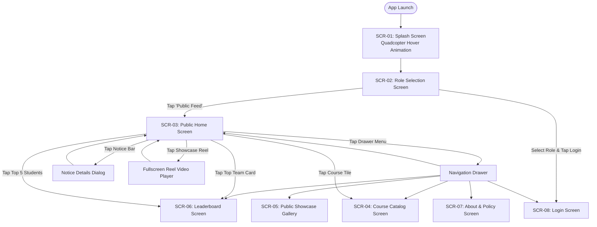
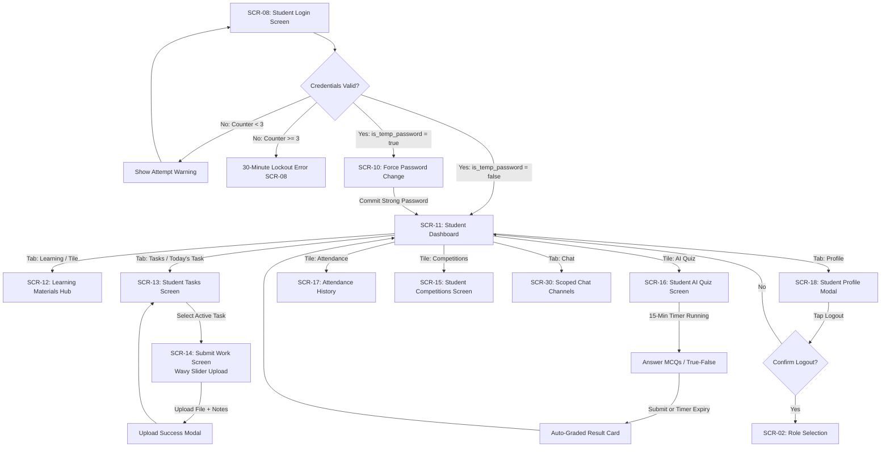
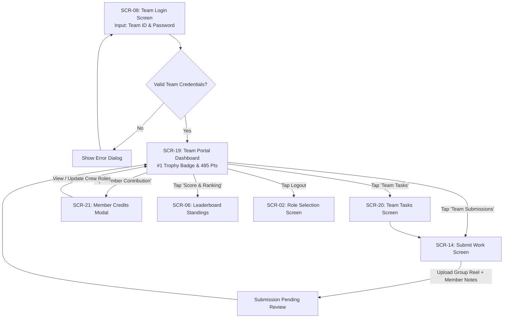
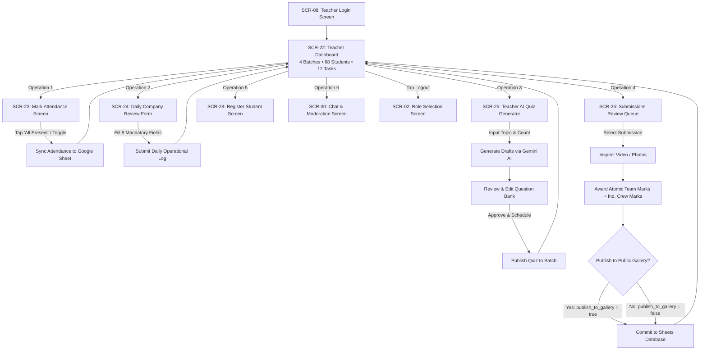
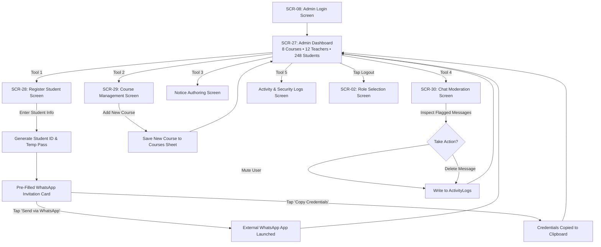

# APPLICATION FLOW & NAVIGATION ARCHITECTURE (APP_FLOW.md)
## DFM KORBA OFFICIAL MOBILE APPLICATION
### Complete Screen Inventory, Role-Based State Machines & Navigation Specifications

---

| Document Metadata | Value |
|---|---|
| **Document Title** | Application Flow & Navigation Architecture |
| **Document Version** | 2.0.0 (Master Navigation Specification) |
| **System** | DFM Korba Official Mobile Application |
| **Platforms** | Android & iOS (Cross-Platform Flutter Client) |
| **Authorization Paradigm** | Server-Validated Role-Based Access Control (RBAC) |
| **Status** | Approved Master Specification |

---

## 1. Complete Master Screen Inventory & Security Registry

The DFM Korba Official App contains **30 distinct screens** cataloged in the registry below. Direct navigation or deep linking to any protected screen without an authenticated, active session token carrying the requisite role is intercepted and routed to the `RoleSelectionScreen`.

| Screen ID | Screen Name | Route Path | Access Permission | Entry Conditions | Exit Conditions |
|---|---|---|---|---|---|
| **SCR-01** | Splash Screen | `/splash` | Public | App launched / process restarted | Bootstrap initialized ($\le 2.2\text{s}$) |
| **SCR-02** | Role Selection Screen | `/role_select` | Public | Unauthenticated or user logged out | User selects role or clicks public feed |
| **SCR-03** | Public Home Screen | `/public/home` | Public | Visited from role select or bottom bar | Navigates to catalog, gallery or login |
| **SCR-04** | Course Catalog Screen | `/public/courses` | Public | Taps "Courses" from public feed | Selects course or returns home |
| **SCR-05** | Public Gallery Screen | `/public/gallery` | Public | Taps "Gallery" from public feed | Inspects media or returns home |
| **SCR-06** | Leaderboard Screen | `/public/leaderboard` | Public | Taps "Top Teams" / "Top Students" | Returns to home or selects squad |
| **SCR-07** | About & Policy Screen | `/public/about` | Public | Taps "About" in navigation drawer | Returns to home |
| **SCR-08** | Login Screen | `/auth/login` | Public | Role selected in SCR-02 | Valid credentials verified |
| **SCR-09** | Forgot Password Modal | `/auth/forgot_password` | Public | Taps "Forgot Password?" in SCR-08 | OTP verified or dialog dismissed |
| **SCR-10** | Force Password Change | `/auth/force_password_change` | Authenticated (Temp Password) | `is_temp_password == true` | New strong password committed |
| **SCR-11** | Student Dashboard | `/student/dashboard` | Student | Active session, role = `STUDENT` | Selects feature or logs out |
| **SCR-12** | Learning Materials Hub | `/student/materials` | Student | Taps "Study Material" tile | Opens document or returns |
| **SCR-13** | Student Tasks Screen | `/student/tasks` | Student | Taps "My Tasks" tile or tab bar | Selects task for submission |
| **SCR-14** | Submit Work Screen | `/student/tasks/submit` | Student, Team | Selects active task to upload | File uploaded to Drive or canceled |
| **SCR-15** | Student Competitions | `/student/competitions` | Student, Team | Taps "Competitions" from dashboard | Views rules or returns |
| **SCR-16** | Student AI Quiz Screen | `/student/quiz` | Student | Taps "AI Quiz" tile (quiz is LIVE) | Completes quiz or timer reaches 0 |
| **SCR-17** | Student Attendance Log | `/student/attendance` | Student | Taps "Attendance" tile | Views history and returns |
| **SCR-18** | Student Profile Screen | `/student/profile` | Student | Taps "Profile" tab | Logs out or edits preferences |
| **SCR-19** | Team Dashboard | `/team/dashboard` | Team | Active session, role = `TEAM` | Selects squad action or logs out |
| **SCR-20** | Team Tasks Screen | `/team/tasks` | Team | Taps "Team Tasks" tile | Selects squad task or returns |
| **SCR-21** | Member Credits Modal | `/team/member_credits` | Team | Taps "Member Contribution" | Updates credits or dismisses |
| **SCR-22** | Teacher Dashboard | `/teacher/dashboard` | Teacher, Admin | Active session, role = `TEACHER`/`ADMIN` | Selects operation or logs out |
| **SCR-23** | Mark Attendance Screen | `/teacher/attendance` | Teacher, Admin | Taps "Mark Batch Attendance" | Saves attendance sync or cancels |
| **SCR-24** | Daily Review Screen | `/teacher/daily_review` | Teacher, Admin | Taps "Daily Company Review" | Submits 8 fields or cancels |
| **SCR-25** | Teacher AI Quiz Generator | `/teacher/ai_quiz` | Teacher, Admin | Taps "AI Quiz Generator" | Approves/schedules or cancels |
| **SCR-26** | Submissions Review Queue | `/teacher/submissions/review` | Teacher, Admin | Taps "Submissions Queue" | Commits dual marks or cancels |
| **SCR-27** | Admin Dashboard | `/admin/dashboard` | Admin | Active session, role = `ADMIN` | Selects admin tool or logs out |
| **SCR-28** | Register Student Screen | `/admin/students/register` | Admin, Teacher | Taps "Register Student" | WhatsApp invite launched |
| **SCR-29** | Course Management Screen | `/admin/courses/manage` | Admin | Taps "Manage Courses" | Edits course or returns |
| **SCR-30** | Chat & Moderation Screen | `/chat/room` | Student, Teacher, Admin | Taps "Chat" tab or channel item | Leaves channel or reports message |

---

## 2. Global Role-Based Navigation Flows (Mermaid Diagrams)

### Flow 1: Public Visitor Flow
Unauthenticated users can explore promotional and academic content without barriers, credentials, or certificate monetization prompts.



---

### Flow 2: Student User Flow
Encompasses authentication, mandatory first-login password updates, personalized learning, wavy slider video submissions, timed quizzes, and peer chat.



---

### Flow 3: Team Squad User Flow
Dedicated squad portal access using unique Team ID, ensuring separation from private individual student accounts.



---

### Flow 4: Faculty Instructor (Teacher) User Flow
Operational command center for marking attendance, submitting daily company reviews, generating AI quizzes, and dual marks grading.



---

### Flow 5: System Administrator User Flow
Global administration of multi-course catalogs, faculty scope assignments, student enrollment with WhatsApp hand-offs, and security audit logs.



---

## 3. Detailed Screen Specifications & State Models

### SCR-01: Splash Screen
- **Entry Conditions**: Application process start.
- **Exit Conditions**: Bootstrap verification completes ($\le 2.2\text{s}$). If active session token exists, auto-routes to respective dashboard; otherwise routes to SCR-02.
- **Permissions**: Public.
- **UI State Models**:
  - *Loading State*: Quadcopter drone silhouette hovers vertically with 4 counter-rotating rotor discs and pulsating sonar rings (`DroneLoadingIndicator`).
  - *Error State*: If local storage fails to initialize, displays *"Storage initialization error. Please restart application."* with retry CTA.
  - *Success State*: Seamless shared axis fade-out into target screen.

### SCR-02: Role Selection Screen
- **Entry Conditions**: Routed from SCR-01 (unauthenticated) or when user taps "Logout".
- **Exit Conditions**: User selects a role card and taps "Login as [ROLE] ->", or taps "Public Feed".
- **Permissions**: Public.
- **UI State Models**:
  - *Default State*: 2x2 Neumorphic grid with 4 role cards: Student, Teacher, Team, Admin. Language switcher chip in top-left (English / हिंदी).
  - *Selection State*: Tapped role card illuminates with high-contrast accent border (Student: Teal, Teacher: Purple, Team: Gold, Admin: Cyan).
  - *Empty / Error State*: N/A.

### SCR-03: Public Home Screen
- **Entry Conditions**: Visitor taps "Public Feed" from SCR-02 or bottom navigation.
- **Exit Conditions**: Visitor taps drawer menu, course tile, showcase video, or top "Login" CTA.
- **Permissions**: Public (No authentication required).
- **UI State Models**:
  - *Loading State*: Subtle skeleton placeholders for notices, top team banner, and student cards.
  - *Empty State*: If no notices exist, displays *"No urgent announcements at this time."* If gallery is empty, displays *"Student showcase gallery updating."*
  - *Success State*: Renders Hero Banner, Important Notice Ticker, Top Team Card (Team Veervaan with member avatars, score 485/500, 97.0%), Top 5 Students Leaderboard, and Student Work Gallery.
  - *Error State*: On offline network failure, renders cached local data with a subtle offline banner: *"Viewing offline cached showcase."*

### SCR-08: Login Screen
- **Entry Conditions**: Role selected from SCR-02.
- **Exit Conditions**: Valid session token issued; user routes to dashboard (or SCR-10 if temporary password).
- **Permissions**: Public.
- **UI State Models**:
  - *Input State*: Inset tactile text fields for Mobile Number / Team ID and Password with visibility toggle.
  - *Loading State*: `NeuButton` shrinks into circular process spinner while calling backend `LOGIN` action.
  - *Error State (Invalid Password)*: Alert dialog displaying remaining attempts (e.g. *"Invalid credentials. 2 attempts remaining."*).
  - *Error State (Lockout)*: Red banner displaying *"Account locked due to 3 consecutive failed attempts. Try again in 30 minutes or reset password."*
  - *Success State*: Session saved in `SharedPreferences`, user routed to dashboard.

### SCR-09: Forgot Password Modal (OTP Reset)
- **Entry Conditions**: User taps "Forgot Password?" in SCR-08.
- **Exit Conditions**: 6-digit OTP verified and new password saved, or modal dismissed.
- **Permissions**: Public.
- **UI State Models**:
  - *Input State*: Mobile number and registered email address fields.
  - *OTP Verification State*: 6-digit numeric input with countdown timer (10 minutes validity).
  - *Error State*: *"Invalid or expired OTP. Maximum 5 attempts per 24 hours allowed."*
  - *Success State*: *"Password reset successfully. Please log in with your new password."*

### SCR-10: Force Password Change Screen
- **Entry Conditions**: Authenticated user session where `is_temp_password == true`.
- **Exit Conditions**: Successful commitment of new strong password.
- **Permissions**: Authenticated (Temporary Hold). Direct access to any other screen is blocked.
- **UI State Models**:
  - *Input State*: Current temporary password, new password, confirm new password fields.
  - *Validation State*: Real-time checklist validating $\ge 8$ chars, uppercase letter, number, special character.
  - *Error State*: *"New password cannot match temporary password"* or *"Passwords do not match."*
  - *Success State*: Updates `Users` table (`is_temp_password = false`), displays success snackbar, and redirects to dashboard.

### SCR-11: Student Dashboard Screen
- **Entry Conditions**: Valid student session (`role == 'STUDENT'`).
- **Exit Conditions**: Navigates to feature screens or logs out.
- **Permissions**: Student Only.
- **UI State Models**:
  - *Loading State*: Telemetry loading placeholders.
  - *Success State*:
    - Header: *"Hello, Aman - Student • DFM Batch 01"*, drone icon.
    - My Progress Card: 92% performance bar, cumulative marks (490 pts), attendance (98.5%), rank #1.
    - 2x3 Grid: My Course, My Tasks (with badge '3'), Study Material, AI Quiz, My Team, Attendance.
    - Today's Task Spotlight: *"Drone Cinematic Shoot, Due: 12 Nov | 100 Marks"* with "Submit" button.
    - Bottom Nav: Floating Bubble Nav (Dashboard, Learning, Tasks, Chat, Profile).
  - *Error State*: Retry banner on network timeout; displays cached dashboard metrics.

### SCR-14: Submit Work Screen (Wavy Slider Upload)
- **Entry Conditions**: Student or Squad Leader opens assigned task to upload work.
- **Exit Conditions**: File uploaded to Drive and recorded in `Submissions`, or user taps Back.
- **Permissions**: Enrolled Student or Squad Team.
- **UI State Models**:
  - *Picker State*: Cloud upload icon, allowed formats (`MP4`, `MOV`, `JPG`, `PDF`), max size 500 MB.
  - *Selected State*: File pill display (`drone_shoot.mp4 324 MB • Ready`) with remove icon.
  - *Uploading State*: `WavyTrackSlider` oscillates with sinusoidal waves; percentage indicator updates from 0% to 100%.
  - *Contribution Notes State*: Multi-line text field capturing individual member role contributions.
  - *Success State*: Full-screen confirmation dialog with checkmark icon: *"Work Submitted! Status: Pending Review."*
  - *Error State*: *"File exceeds 500 MB limit"* or *"Upload connection lost. Retrying in 5 seconds."*

### SCR-16: Student AI Quiz Screen
- **Entry Conditions**: Student opens scheduled fortnightly quiz (`status == 'LIVE'`).
- **Exit Conditions**: Student submits answers or 15-minute countdown clock expires.
- **Permissions**: Enrolled Student in target batch.
- **UI State Models**:
  - *Timer Active State*: Synchronized countdown clock (`14:59`, `14:58`...) in top app bar.
  - *Question State*: Question card with Neumorphic radio cards for options A, B, C, D. Next/Previous buttons.
  - *Auto-Submit State*: When timer reaches `00:00`, interface disables further selections and auto-submits.
  - *Result State*: Trophy icon, score card (e.g. *"You scored 8 / 10 (80%)"*), correct answer keys, and pedagogical explanations.

### SCR-22: Teacher Dashboard Screen
- **Entry Conditions**: Valid teacher session (`role == 'TEACHER'` or `'ADMIN'`).
- **Exit Conditions**: Navigates to faculty operational tools or logs out.
- **Permissions**: Faculty Instructor / Administrator.
- **UI State Models**:
  - *Metrics Grid*: 4 Batches, 68 Students, 12 Tasks, 6 Competitions.
  - *Operations List*:
    1. Mark Batch Attendance
    2. Daily Company Review
    3. AI Quiz Generator (Gemini)
    4. Submissions Review Queue
  - *Empty State*: If no submissions pending review, displays *"Review queue clear. All student work graded."*

### SCR-23: Mark Batch Attendance Screen
- **Entry Conditions**: Teacher opens attendance from SCR-22.
- **Exit Conditions**: Attendance records saved and synced to Google Sheet, or teacher taps Back.
- **Permissions**: Assigned Teacher or Administrator.
- **UI State Models**:
  - *Roster State*: Student list matched to unique Student IDs (`STU_DFM_001`, `STU_DFM_002`...).
  - *Toggle State*: Tapping "All Present" turns all cards green (`PRESENT`). Tapping an individual student card toggles to red (`ABSENT`).
  - *Saving State*: `NeuButton` displays process spinner while invoking `SAVE_ATTENDANCE`.
  - *Success State*: Snackbar confirming *"Attendance synchronized with Google Sheet for X students."*

### SCR-24: Daily Company Review Form Screen
- **Entry Conditions**: Teacher opens daily review from SCR-22.
- **Exit Conditions**: 8-field report committed to `DailyReviews` sheet.
- **Permissions**: Faculty Instructor or Administrator.
- **UI State Models**:
  - *Form State*: 8 project owner fields (Date, Course, Batch, Instructor, Activities Completed, Student Progress, Challenges Faced, Work Completed, Overall Remarks).
  - *Validation State*: Enforces non-empty content in all 8 fields.
  - *Success State*: Confirms *"Daily Company Review submitted successfully."*

### SCR-25: Teacher AI Quiz Generator Screen
- **Entry Conditions**: Teacher opens AI quiz tool from SCR-22.
- **Exit Conditions**: Quiz approved and scheduled, or canceled.
- **Permissions**: Faculty Instructor or Administrator.
- **UI State Models**:
  - *Configuration State*: Topic text field, question count dropdown (5, 10, 15), difficulty selector (Beginner, Intermediate, Advanced).
  - *AI Generating State*: Process animation while Apps Script calls Gemini 1.5 API.
  - *Review & Approval State*: Renders generated MCQs with options, correct answer keys, and explanations. Teacher can edit text or swap questions.
  - *Schedule State*: Sets 15-day availability window, pass marks, and commits `APPROVE_AND_SCHEDULE_QUIZ`.

### SCR-26: Submissions Review Queue (Dual Marks Engine)
- **Entry Conditions**: Teacher opens review queue from SCR-22.
- **Exit Conditions**: Marks committed to `TeamMarks` and `IndividualMarks` sheets.
- **Permissions**: Faculty Instructor or Administrator.
- **UI State Models**:
  - *Video Inspection State*: Video player thumbnail with stream link (`drone_shoot.mp4 324 MB`).
  - *Decision State*: Choice chips (`APPROVED`, `REJECTED`, `RESUBMISSION_REQ`).
  - *Dual Marks Entry State*:
    - Squad Score: Atomic score entry (e.g. `95 / 100`) recorded to `TeamMarks` (never multiplied by member count).
    - Individual Crew Breakdown: Specific marks per member (Aman: 95 [Pilot], Rahul: 92 [Gimbal], Priya: 96 [Colorist]) recorded to `IndividualMarks`.
  - *Gallery Toggle*: Switch for `publish_to_gallery`.
  - *Success State*: *"Submission evaluated! Dual marks recorded."*

### SCR-27: Admin Dashboard Screen
- **Entry Conditions**: Valid administrator session (`role == 'ADMIN'`).
- **Exit Conditions**: Navigates to administrative tools or logs out.
- **Permissions**: System Administrator Only.
- **UI State Models**:
  - *Metrics Grid*: 8 Courses, 12 Teachers, 248 Students, 28 Teams.
  - *Tools List*: Register Student & WhatsApp Onboard, Manage Courses, Publish System Notices, Security & Activity Logs.

### SCR-28: Register Student Screen (WhatsApp Onboarding)
- **Entry Conditions**: Admin or Teacher opens student registration.
- **Exit Conditions**: Student saved, credentials generated, WhatsApp invite launched.
- **Permissions**: Administrator or Teacher.
- **UI State Models**:
  - *Input Form State*: Full name, 10-digit mobile number, email, course dropdown, batch dropdown.
  - *Processing State*: Backend generates Student ID (`STU_DFM_xxx`), temporary password (`Dfm#...`), and pre-formatted invitation message.
  - *Onboarding Hand-off State*:
    - Displays Student ID, Full Name, Mobile, and Temp Password card.
    - Pre-filled WhatsApp message card.
    - Green Button: *"Send Invitation via WhatsApp  📱"* (launches WhatsApp with pre-filled text).
    - Dark Button: *"Copy Credentials to Clipboard  📋"*.
    - Link: *"Register Another Student"*.

### SCR-30: Chat & Moderation Screen
- **Entry Conditions**: User taps "Chat" tab from dashboard.
- **Exit Conditions**: User returns to dashboard or exits room.
- **Permissions**: Student, Teacher, Admin (scoped by channel membership).
- **UI State Models**:
  - *Channel Selector State*: Horizontal chips for Team Veervaan Squad, DFM Batch 01 Main, and P2P peer channels.
  - *Stream State*: Timeline showing incoming/outgoing bubbles with timestamps and sender role tags.
  - *Input State*: Text box with arrow send button (`ArrowLaunchButton`).
  - *Report Modal State*: Tapping flag icon opens report dialog with reason options (Inappropriate language, spam, harassment).
  - *Moderation State (Admin/Teacher)*: Option to mute bad actors or delete flagged messages.

---

## 4. Navigation Guards & Route Access Enforcement

The mobile client implements declarative route guards in Dart to ensure that unauthorized users cannot reach protected screens through direct navigation or state spoofing:

```dart
// Core Route Protection Guard Concept
Widget guardRoute({
  required BuildContext context,
  required Widget destination,
  required List<String> allowedRoles,
}) {
  final auth = context.read<AuthProvider>();

  // 1. Unauthenticated check
  if (!auth.isAuthenticated) {
    return const RoleSelectionScreen();
  }

  // 2. Forced Temporary Password Change check
  if (auth.isTempPassword && destination.runtimeType != ForcePasswordChangeScreen) {
    return const ForcePasswordChangeScreen();
  }

  // 3. Role-Based Access Control check
  if (!allowedRoles.contains(auth.userRole)) {
    return const RoleSelectionScreen();
  }

  return destination;
}
```

---
*End of Application Flow & Navigation Architecture (APP_FLOW.md).*
