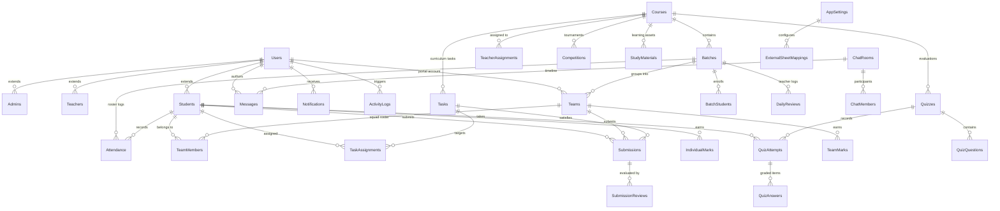

# DFM KORBA OFFICIAL APP – DATABASE SCHEMA SPECIFICATION
## Primary Structured Database: Google Sheets (32 Tables / Sheets)
### Production Relational Schema, External Sheet Mapping Architecture, Validation Rules, Indexes & Deployment Guide

| Document Attribute | Specification Details |
|---|---|
| **System** | DFM Korba Official Mobile Application |
| **Primary Database** | Google Sheets (32 Normalized Relational Worksheets) |
| **Backend Engine** | Google Apps Script (V8 Engine with ScriptLock Concurrency) |
| **Media & File Store** | Google Drive Enterprise Hierarchical Storage |
| **External Integration**| Configurable Bi-directional Mapping for Owner-Supplied Attendance & Daily Review Sheets |
| **AI Integration** | Google Gemini 1.5 Flash API (Server-side Keys) |
| **Compliance** | Strict No-Certificate Policy • 100% Free Learning • Dual Marks Engine |

---

## 1. Core Data Integrity & Architecture Principles

1. **Immutable Permanent Identifiers**: Every record utilizes an explicit alphanumeric primary key (e.g. `USR_001`, `STU_DFM_001`, `CRS_DRONE`, `TSK_001`, `SUB_001`, `ATT_001`). Operations never rely on row index numbers, which can shift during sorting or row insertions.
2. **Standard Audit Columns**: Every mutable entity table includes `created_at` (ISO 8601 UTC string), `updated_at`, and `status`.
3. **Strict Zero Binary Storage in Google Sheets**:
   - Google Sheets cells store metadata only (`drive_file_id`, `drive_web_view_link`, `file_name`, `mime_type`, `file_size_bytes`).
   - High-resolution 4K drone video files, RAW frames, audio stems, PDF curriculums, and PPT slides are streamed directly into designated Google Drive folders.
4. **Soft Deletes & Data Retention**: Destructive operations set `status = 'DELETED'` or `'DEACTIVATED'`, ensuring referential integrity and audit trails for student marks and historical competitions.
5. **Dual Marks Engine Independence**:
   - `TeamMarks` stores atomic team assessment scores (single score for squad, e.g. 485/500). Team marks are **never** multiplied by squad member counts.
   - `IndividualMarks` stores student-specific practical evaluations and contributions.
6. **Student ID Matching Invariant**: Attendance and marks must match the permanent unique `student_id` (e.g. `STU_DFM_001`), preventing collisions between students who share similar or identical full names.
7. **Concurrency Control via V8 ScriptLock**: All mutating batch writes invoke `LockService.getScriptLock().waitLock(15000)` to ensure atomic ACID-compliant transactions across concurrent mobile requests.

---

## 2. Entity-Relationship (ER) Architecture Diagram



---

## 3. Configurable External Sheet Mapping Architecture

The DFM Korba platform features a dedicated **External Sheet Mapping & Synchronization Engine** to integrate directly with pre-existing, owner-supplied Google Sheets for Attendance and Daily Company Reviews.

```
       +--------------------------------------------------------------+
       |             DFM Korba Official Mobile App                    |
       +--------------------------------------------------------------+
                                      |
                                      | HTTPS POST / API
                                      v
       +--------------------------------------------------------------+
       |             Google Apps Script Backend API                   |
       |  (AuthService, AttendanceService, ManagementService, etc.)   |
       +--------------------------------------------------------------+
                       |                              |
      (Internal Normalized Writes)        (Configurable External Sync)
                       v                              v
       +-------------------------------+  +-------------------------------+
       |   DFM_KORBA_DATABASE          |  |  Owner's Pre-Existing Sheets  |
       |   (Primary Normalized Sheets) |  |  (Legacy Attendance / Review) |
       |   • Attendance (32 Tables)    |  |  • Custom Column Headers      |
       |   • DailyReviews              |  |  • Custom Row Formats         |
       +-------------------------------+  +-------------------------------+
```

### 3.1 AppSettings Mapping Configuration Schema
The owner configures external Google Sheet IDs and custom column mappings through `AppSettings` via the Admin Portal or `CONFIGURE_EXTERNAL_SHEET_MAPPING` API:

| AppSetting Key | Data Type | Example Value | Description |
|---|---|---|---|
| `EXT_ATTENDANCE_ENABLED` | BOOLEAN | `"TRUE"` | Master toggle for external attendance mirroring |
| `EXT_ATTENDANCE_SHEET_ID` | STRING | `"1BxiMVs0XRA5nFMdKvBdBZjgmUUqptlbs74OgvE2upms"` | Google Sheet ID of owner's existing attendance document |
| `EXT_ATTENDANCE_SHEET_NAME` | STRING | `"Batch_01_Attendance"` | Worksheet tab name in external spreadsheet |
| `EXT_ATTENDANCE_MAPPING` | JSON STRING | See Matrix Below | Bidirectional mapping between external headers & internal schema |
| `EXT_DAILY_REVIEW_ENABLED` | BOOLEAN | `"TRUE"` | Master toggle for external review mirroring |
| `EXT_DAILY_REVIEW_SHEET_ID` | STRING | `"1AbC9XyZ...ownerReviewSheetId"` | Google Sheet ID of owner's daily operations log |
| `EXT_DAILY_REVIEW_SHEET_NAME`| STRING | `"Daily_Company_Reports"` | Worksheet tab name in external spreadsheet |
| `EXT_DAILY_REVIEW_MAPPING` | JSON STRING | See Matrix Below | Column header mapping for 8-field review reports |

### 3.2 Attendance Field Mapping Matrix
The owner's existing sheet may use arbitrary column headers. The mapping engine dynamically translates records:

| Owner's External Column Header | Internal DFM Schema Attribute | Transformation Rule |
|---|---|---|
| `"Date"` / `"Flight Date"` | `date` | Formats to `YYYY-MM-DD` |
| `"Roll Number"` / `"Student ID"` | `student_id` | Strict match against `Students.student_id` |
| `"Student Name"` / `"Name"` | `student_name` | Verified against `Users.full_name` |
| `"Attendance Status (P/A)"` | `status` | Standardized to `PRESENT`, `ABSENT`, or `EXCUSED` |
| `"Batch Code"` / `"Cohort"` | `batch_id` | Maps to `Batches.batch_id` |
| `"Instructor / Marked By"` | `marked_by` | Records teacher `user_id` or full name |
| `"Sync Timestamp"` | `created_at` | Injects current UTC timestamp |

### 3.3 Daily Review Field Mapping Matrix
Matches the 8 mandatory operational reporting fields required by project stakeholders:

| Owner's External Column Header | Internal DFM Schema Attribute | Required Field Description |
|---|---|---|
| `"Report Date"` | `date` | Date of operational session |
| `"Instructor Name"` | `teacher_name` | Name of submitting faculty member |
| `"Batch / Squad"` | `batch_id` | Target cohort identified |
| `"Topics & Practicals Covered"`| `activities_completed`| Specific drone flight or editing drills executed |
| `"Student Learning Progress"` | `student_progress` | Skill progression summary |
| `"Operational Challenges"` | `challenges_faced` | Hardware, weather, or venue issues |
| `"Completed Projects & Reels"` | `work_completed` | Specific drone reels or practical tasks completed |
| `"Executive Remarks"` | `overall_remarks` | Teacher's overall assessment & recommendations |

---

## 4. Complete Relational Table Specifications (32 Worksheets)

#### 1. `Users`
Master identity authentication record for all roles.
| Column | Type | Constraints / Description |
|---|---|---|
| `user_id` | STRING (PK) | e.g. `USR_001` (Unique alphanumeric ID) |
| `mobile_number` | STRING | 10-digit mobile number (Indexed, Unique) |
| `email` | STRING | Email address for OTP recovery |
| `password_hash` | STRING | SHA-256 with per-user 16-byte random salt |
| `salt` | STRING | Cryptographic 16-byte hex salt |
| `role` | STRING | Enum: `ADMIN`, `TEACHER`, `STUDENT`, `TEAM` |
| `full_name` | STRING | Display name |
| `avatar_url` | STRING | Drive file link or asset reference |
| `is_temp_password`| BOOLEAN | `TRUE` if forced first-login rotation required |
| `failed_login_attempts` | INTEGER | Counter; locks out at $\ge 3$ for 30 minutes |
| `lockout_until` | STRING | ISO timestamp if account locked |
| `session_token` | STRING | Active SHA-256 session token hash |
| `token_expiry` | STRING | ISO timestamp (Default: 30-day rolling expiration) |
| `created_at` | STRING | ISO 8601 UTC timestamp |
| `updated_at` | STRING | ISO 8601 UTC timestamp |
| `status` | STRING | Enum: `ACTIVE`, `SUSPENDED`, `LOCKED` |

#### 2. `Admins`
System administrator profile extensions.
| Column | Type | Constraints / Description |
|---|---|---|
| `admin_id` | STRING (PK) | e.g. `ADM_001` |
| `user_id` | STRING (FK) | Reference `Users.user_id` |
| `super_admin` | BOOLEAN | Full root system management |
| `department` | STRING | Admin department (e.g. "Operations") |
| `created_at` | STRING | ISO 8601 UTC timestamp |
| `updated_at` | STRING | ISO 8601 UTC timestamp |

#### 3. `Teachers`
Faculty and instructor profiles.
| Column | Type | Constraints / Description |
|---|---|---|
| `teacher_id` | STRING (PK) | e.g. `TCH_001` |
| `user_id` | STRING (FK) | Reference `Users.user_id` |
| `specialization` | STRING | e.g. "Aerial Cinematography & Color Grading" |
| `designation` | STRING | e.g. "Lead Drone Instructor" |
| `assigned_courses` | STRING | JSON array of Course IDs `["CRS_DRONE"]` |
| `can_create_quiz` | BOOLEAN | Permission flag |
| `can_moderate_chat` | BOOLEAN | Permission flag |
| `created_at` | STRING | ISO 8601 UTC timestamp |
| `updated_at` | STRING | ISO 8601 UTC timestamp |
| `status` | STRING | Enum: `ACTIVE`, `INACTIVE` |

#### 4. `Students`
Enrolled student records.
| Column | Type | Constraints / Description |
|---|---|---|
| `student_id` | STRING (PK) | e.g. `STU_DFM_001` (Official unique Student ID) |
| `user_id` | STRING (FK) | Reference `Users.user_id` |
| `primary_course_id` | STRING (FK) | Reference `Courses.course_id` |
| `batch_id` | STRING (FK) | Reference `Batches.batch_id` |
| `team_id` | STRING (FK) | Reference `Teams.team_id` (Nullable) |
| `enrollment_date` | STRING | `YYYY-MM-DD` |
| `guardian_contact` | STRING | Emergency / guardian phone |
| `cumulative_marks` | NUMBER | Total individual marks earned |
| `attendance_pct` | NUMBER | Real-time percentage attendance ($0.0 - 100.0$) |
| `rank_in_batch` | INTEGER | Current rank |
| `created_at` | STRING | ISO 8601 UTC timestamp |
| `updated_at` | STRING | ISO 8601 UTC timestamp |
| `status` | STRING | Enum: `ENROLLED`, `DROPPED`, `GRADUATED` |

#### 5. `Courses`
Skill Development courses (Multi-course capability).
| Column | Type | Constraints / Description |
|---|---|---|
| `course_id` | STRING (PK) | e.g. `CRS_DRONE`, `CRS_MOBILE_REP`, `CRS_FRONT_OFFICE` |
| `course_name` | STRING | e.g. "Drone Film Making" |
| `code` | STRING | Short code: "DFM" |
| `description` | STRING | Comprehensive syllabus overview |
| `course_image` | STRING | Drive image link or asset path |
| `total_modules` | INTEGER | Module count |
| `duration_weeks` | INTEGER | Duration in weeks |
| `is_free` | BOOLEAN | Always `TRUE` for DFM Korba |
| `created_at` | STRING | ISO 8601 UTC timestamp |
| `updated_at` | STRING | ISO 8601 UTC timestamp |
| `status` | STRING | Enum: `ACTIVE`, `ARCHIVED` |

#### 6. `TeacherAssignments`
Course-to-Teacher mapping with explicit permission scopes.
| Column | Type | Constraints / Description |
|---|---|---|
| `assignment_id` | STRING (PK) | e.g. `TA_001` |
| `teacher_id` | STRING (FK) | Reference `Teachers.teacher_id` |
| `course_id` | STRING (FK) | Reference `Courses.course_id` |
| `can_grade` | BOOLEAN | Flag to award task and competition marks |
| `can_publish_gallery` | BOOLEAN | Flag to approve student work to public gallery |
| `created_at` | STRING | ISO 8601 UTC timestamp |
| `status` | STRING | Enum: `ACTIVE`, `REVOKED` |

#### 7. `Batches`
Academic cohorts within courses.
| Column | Type | Constraints / Description |
|---|---|---|
| `batch_id` | STRING (PK) | e.g. `BTC_DFM_01` |
| `batch_name` | STRING | e.g. "DFM Batch 01 (Morning)" |
| `course_id` | STRING (FK) | Reference `Courses.course_id` |
| `teacher_id` | STRING (FK) | Reference `Teachers.teacher_id` (Batch Mentor) |
| `start_date` | STRING | `YYYY-MM-DD` |
| `end_date` | STRING | `YYYY-MM-DD` |
| `max_capacity` | INTEGER | Default: 30 |
| `created_at` | STRING | ISO 8601 UTC timestamp |
| `updated_at` | STRING | ISO 8601 UTC timestamp |
| `status` | STRING | Enum: `ACTIVE`, `COMPLETED`, `UPCOMING` |

#### 8. `BatchStudents`
Many-to-many relationship mapping students to batches.
| Column | Type | Constraints / Description |
|---|---|---|
| `id` | STRING (PK) | e.g. `BS_001` |
| `batch_id` | STRING (FK) | Reference `Batches.batch_id` |
| `student_id` | STRING (FK) | Reference `Students.student_id` |
| `assigned_at` | STRING | ISO 8601 UTC timestamp |
| `status` | STRING | Enum: `ACTIVE`, `TRANSFERRED`, `DROPPED` |

#### 9. `Teams`
Collaborative squads for film crews and practical challenges.
| Column | Type | Constraints / Description |
|---|---|---|
| `team_id` | STRING (PK) | e.g. `TM_VEERVAAN` |
| `team_name` | STRING | e.g. "Team Veervaan" |
| `user_id` | STRING (FK) | Reference `Users.user_id` (Team Login Portal) |
| `course_id` | STRING (FK) | Reference `Courses.course_id` |
| `batch_id` | STRING (FK) | Reference `Batches.batch_id` |
| `leader_student_id`| STRING (FK) | Reference `Students.student_id` |
| `team_logo` | STRING | Drive file link or asset reference |
| `total_team_marks` | NUMBER | Atomic collective score (e.g. 485/500) |
| `performance_pct` | NUMBER | Percentage score ($97.0\%$) |
| `rank` | INTEGER | Rank in batch / competition |
| `created_at` | STRING | ISO 8601 UTC timestamp |
| `updated_at` | STRING | ISO 8601 UTC timestamp |
| `status` | STRING | Enum: `ACTIVE`, `DISBANDED` |

#### 10. `TeamMembers`
Roster of students within a team squad.
| Column | Type | Constraints / Description |
|---|---|---|
| `id` | STRING (PK) | e.g. `TM_MEM_001` |
| `team_id` | STRING (FK) | Reference `Teams.team_id` |
| `student_id` | STRING (FK) | Reference `Students.student_id` |
| `role_in_team` | STRING | e.g. "Pilot", "Camera Operator", "Editor", "Gimbal Pilot" |
| `joined_at` | STRING | ISO 8601 UTC timestamp |
| `status` | STRING | Enum: `ACTIVE`, `REMOVED` |

#### 11. `Tasks`
Assignments and practical drone challenges.
| Column | Type | Constraints / Description |
|---|---|---|
| `task_id` | STRING (PK) | e.g. `TSK_001` |
| `title` | STRING | e.g. "Drone Cinematic Shoot" |
| `description` | STRING | Practical flight and framing instructions |
| `course_id` | STRING (FK) | Reference `Courses.course_id` |
| `batch_id` | STRING (FK) | Reference `Batches.batch_id` |
| `task_type` | STRING | Enum: `PRACTICAL_CHALLENGE`, `THEORY_ASSIGNMENT`, `FIELD_MISSION` |
| `target_scope` | STRING | Enum: `INDIVIDUAL`, `TEAM` |
| `assigned_by` | STRING (FK) | Reference `Teachers.teacher_id` |
| `start_date` | STRING | `YYYY-MM-DD` |
| `deadline` | STRING | `YYYY-MM-DD HH:MM` |
| `max_marks` | NUMBER | Maximum marks (e.g. 100) |
| `attachment_url` | STRING | Drive link to guidelines or sample clip |
| `allowed_formats`| STRING | JSON array: `["MP4", "MOV", "JPG", "PDF"]` |
| `max_file_size_mb`| INTEGER | Default: 500 MB |
| `created_at` | STRING | ISO 8601 UTC timestamp |
| `status` | STRING | Enum: `ACTIVE`, `CLOSED`, `ARCHIVED` |

#### 12. `TaskAssignments`
Target mapping for tasks to students or teams.
| Column | Type | Constraints / Description |
|---|---|---|
| `assignment_id` | STRING (PK) | e.g. `TAS_001` |
| `task_id` | STRING (FK) | Reference `Tasks.task_id` |
| `assignee_type` | STRING | Enum: `STUDENT`, `TEAM` |
| `assignee_id` | STRING | `student_id` or `team_id` |
| `submission_status`| STRING | Enum: `PENDING`, `SUBMITTED`, `EVALUATED`, `LATE` |
| `assigned_at` | STRING | ISO 8601 UTC timestamp |

#### 13. `Submissions`
Student practical file uploads.
| Column | Type | Constraints / Description |
|---|---|---|
| `submission_id` | STRING (PK) | e.g. `SUB_001` |
| `task_id` | STRING (FK) | Reference `Tasks.task_id` |
| `submitter_type` | STRING | Enum: `INDIVIDUAL`, `TEAM` |
| `submitter_id` | STRING | `student_id` or `team_id` |
| `uploaded_by_user_id`| STRING (FK)| Reference `Users.user_id` |
| `drive_file_id` | STRING | Google Drive permanent file ID |
| `drive_web_view_link`| STRING| Google Drive direct stream URL |
| `file_name` | STRING | e.g. `drone_shoot.mp4` |
| `file_size_bytes` | NUMBER | File size in bytes |
| `mime_type` | STRING | `video/mp4`, `image/jpeg`, etc. |
| `contribution_notes`| STRING | Notes explaining squad member contributions |
| `submission_status`| STRING | Enum: `PENDING_REVIEW`, `APPROVED`, `REJECTED`, `RESUBMISSION_REQUESTED` |
| `submitted_at` | STRING | ISO 8601 UTC timestamp |
| `version` | INTEGER | Incremented on resubmission |

#### 14. `SubmissionReviews`
Teacher evaluation, grading, and public showcase approval.
| Column | Type | Constraints / Description |
|---|---|---|
| `review_id` | STRING (PK) | e.g. `REV_001` |
| `submission_id` | STRING (FK) | Reference `Submissions.submission_id` |
| `reviewed_by` | STRING (FK) | Reference `Teachers.teacher_id` |
| `awarded_marks` | NUMBER | Score awarded |
| `feedback_comments`| STRING | Constructive feedback on flight, framing, edit |
| `decision` | STRING | Enum: `APPROVED`, `REJECTED`, `REVISION_REQUIRED` |
| `publish_to_gallery`| BOOLEAN | `TRUE` to display on Public Home Showcase |
| `reviewed_at` | STRING | ISO 8601 UTC timestamp |

#### 15. `Competitions`
Tournaments and grand challenges.
| Column | Type | Constraints / Description |
|---|---|---|
| `competition_id`| STRING (PK) | e.g. `CMP_001` |
| `title` | STRING | e.g. "Cinematic Drone Short Film 2026" |
| `description` | STRING | Rules, shot list, duration, audio requirements |
| `course_id` | STRING (FK) | Reference `Courses.course_id` |
| `rules` | STRING | Safety, DGCA compliance, permitted gear |
| `start_date` | STRING | `YYYY-MM-DD` |
| `end_date` | STRING | `YYYY-MM-DD` |
| `max_marks` | NUMBER | Maximum marks (e.g. 500) |
| `created_by` | STRING (FK) | Reference `Teachers.teacher_id` |
| `status` | STRING | Enum: `UPCOMING`, `ACTIVE`, `EVALUATING`, `CONCLUDED` |

#### 16. `CompetitionParticipants`
Enrolled teams and students in competitions.
| Column | Type | Constraints / Description |
|---|---|---|
| `id` | STRING (PK) | e.g. `CP_001` |
| `competition_id`| STRING (FK) | Reference `Competitions.competition_id` |
| `participant_type`| STRING | Enum: `TEAM`, `INDIVIDUAL` |
| `participant_id`| STRING | `team_id` or `student_id` |
| `submission_id` | STRING (FK) | Reference `Submissions.submission_id` (Nullable) |
| `final_rank` | INTEGER | Final standing (1, 2, 3...) |
| `total_score` | NUMBER | Cumulative competition score |
| `registered_at` | STRING | ISO 8601 UTC timestamp |

#### 17. `IndividualMarks`
Student individual mark history (Dual Marks Engine Part 1).
| Column | Type | Constraints / Description |
|---|---|---|
| `mark_id` | STRING (PK) | e.g. `IMK_001` |
| `student_id` | STRING (FK) | Reference `Students.student_id` (Strict ID match) |
| `assessment_type`| STRING | Enum: `TASK`, `QUIZ`, `PRACTICAL_EXAM`, `VIVA` |
| `source_ref_id` | STRING | Reference `task_id` or `quiz_id` |
| `max_marks` | NUMBER | Max possible |
| `marks_obtained`| NUMBER | Score earned |
| `awarded_by` | STRING (FK) | Reference `Teachers.teacher_id` |
| `feedback` | STRING | Specific evaluation notes |
| `created_at` | STRING | ISO 8601 UTC timestamp |

#### 18. `TeamMarks`
Atomic collective squad marks (Dual Marks Engine Part 2).
| Column | Type | Constraints / Description |
|---|---|---|
| `team_mark_id` | STRING (PK) | e.g. `TMK_001` |
| `team_id` | STRING (FK) | Reference `Teams.team_id` (Strict ID match) |
| `assessment_type`| STRING | Enum: `TEAM_TASK`, `COMPETITION` |
| `source_ref_id` | STRING | Reference `task_id` or `competition_id` |
| `max_marks` | NUMBER | Max possible (e.g. 500) |
| `marks_obtained`| NUMBER | Atomic squad score (e.g. 485; **NEVER multiplied**) |
| `awarded_by` | STRING (FK) | Reference `Teachers.teacher_id` |
| `feedback` | STRING | Collective squad critique |
| `created_at` | STRING | ISO 8601 UTC timestamp |

#### 19. `Attendance`
Attendance record matching Student IDs.
| Column | Type | Constraints / Description |
|---|---|---|
| `attendance_id` | STRING (PK) | e.g. `ATT_001` |
| `date` | STRING | `YYYY-MM-DD` |
| `course_id` | STRING (FK) | Reference `Courses.course_id` |
| `batch_id` | STRING (FK) | Reference `Batches.batch_id` |
| `student_id` | STRING (FK) | Reference `Students.student_id` (Strict ID match) |
| `student_name` | STRING | Snapshot of student full name |
| `status` | STRING | Enum: `PRESENT`, `ABSENT`, `EXCUSED`, `LATE` |
| `marked_by` | STRING (FK) | Reference `Teachers.teacher_id` |
| `sync_status` | STRING | Enum: `LOCAL_SAVED`, `SYNCED`, `EXTERNAL_MIRRORED` |
| `created_at` | STRING | ISO 8601 UTC timestamp |

#### 20. `StudyMaterials`
Curriculum documents, videos, and slides.
| Column | Type | Constraints / Description |
|---|---|---|
| `material_id` | STRING (PK) | e.g. `MAT_001` |
| `course_id` | STRING (FK) | Reference `Courses.course_id` |
| `batch_id` | STRING (FK) | Reference `Batches.batch_id` (Nullable if course-wide) |
| `module_name` | STRING | e.g. "Module 1: Drone Fundamentals" |
| `chapter_name` | STRING | e.g. "DGCA Rules & Airspace Classification" |
| `title` | STRING | e.g. "Digital Sky Airspace Maps & Guidelines" |
| `description` | STRING | Study resource summary |
| `file_format` | STRING | Enum: `PDF`, `VIDEO`, `PPTX`, `DOCX`, `IMAGE` |
| `drive_file_id` | STRING | Google Drive file ID |
| `drive_web_link`| STRING | Drive download / stream link |
| `file_size_bytes`| NUMBER | Resource size in bytes |
| `uploaded_by` | STRING (FK) | Reference `Teachers.teacher_id` |
| `created_at` | STRING | ISO 8601 UTC timestamp |
| `status` | STRING | Enum: `ACTIVE`, `ARCHIVED` |

#### 21. `Quizzes`
Bi-weekly scheduled evaluations.
| Column | Type | Constraints / Description |
|---|---|---|
| `quiz_id` | STRING (PK) | e.g. `QZ_001` |
| `title` | STRING | e.g. "Drone Cinematography Bi-Weekly Quiz #1" |
| `course_id` | STRING (FK) | Reference `Courses.course_id` |
| `batch_id` | STRING (FK) | Reference `Batches.batch_id` |
| `topic` | STRING | Topic for AI generation |
| `source_material_id`| STRING (FK)| Reference `StudyMaterials.material_id` (Nullable) |
| `total_questions`| INTEGER | e.g. 10 |
| `duration_minutes`| INTEGER | Default: 15 minutes |
| `max_marks` | NUMBER | Default: 100 |
| `pass_marks` | NUMBER | Default: 60 |
| `start_window` | STRING | ISO timestamp |
| `end_window` | STRING | ISO timestamp |
| `ai_generated` | BOOLEAN | `TRUE` if generated via Google Gemini |
| `teacher_approved`| BOOLEAN | **Mandatory human review gate** (`FALSE` = draft) |
| `approved_by` | STRING (FK) | Reference `Teachers.teacher_id` |
| `created_at` | STRING | ISO 8601 UTC timestamp |
| `status` | STRING | Enum: `DRAFT`, `SCHEDULED`, `ACTIVE`, `CONCLUDED` |

#### 22. `QuizQuestions`
Individual questions within quizzes.
| Column | Type | Constraints / Description |
|---|---|---|
| `question_id` | STRING (PK) | e.g. `QQ_001` |
| `quiz_id` | STRING (FK) | Reference `Quizzes.quiz_id` |
| `question_type` | STRING | Enum: `MCQ_SINGLE`, `TRUE_FALSE` |
| `question_text` | STRING | Question description |
| `option_a` | STRING | Option A text |
| `option_b` | STRING | Option B text |
| `option_c` | STRING | Option C text |
| `option_d` | STRING | Option D text |
| `correct_answer`| STRING | e.g. `"A"` or exact option string |
| `explanation` | STRING | Explanatory note shown after auto-evaluation |
| `marks` | NUMBER | Marks per question (e.g. 10) |
| `order_index` | INTEGER | Display order (1, 2, 3...) |

#### 23. `QuizAttempts`
Student timed submissions and auto-graded results.
| Column | Type | Constraints / Description |
|---|---|---|
| `attempt_id` | STRING (PK) | e.g. `QA_001` |
| `quiz_id` | STRING (FK) | Reference `Quizzes.quiz_id` |
| `student_id` | STRING (FK) | Reference `Students.student_id` |
| `started_at` | STRING | ISO 8601 UTC timestamp |
| `submitted_at` | STRING | ISO 8601 UTC timestamp |
| `score_obtained`| NUMBER | Total marks scored |
| `percentage` | NUMBER | Calculated score percentage |
| `passed` | BOOLEAN | `TRUE` if percentage $\ge$ pass_marks |
| `status` | STRING | Enum: `IN_PROGRESS`, `SUBMITTED`, `EXPIRED_AUTO_SUBMIT` |

#### 24. `QuizAnswers`
Itemized answers per question.
| Column | Type | Constraints / Description |
|---|---|---|
| `answer_id` | STRING (PK) | e.g. `QANS_001` |
| `attempt_id` | STRING (FK) | Reference `QuizAttempts.attempt_id` |
| `question_id` | STRING (FK) | Reference `QuizQuestions.question_id` |
| `student_answer`| STRING | Option selected by student |
| `is_correct` | BOOLEAN | Result of auto-grading |
| `marks_awarded` | NUMBER | Score awarded for this question |

#### 25. `Notices`
System announcements and task alerts.
| Column | Type | Constraints / Description |
|---|---|---|
| `notice_id` | STRING (PK) | e.g. `NOT_001` |
| `category` | STRING | Enum: `GENERAL_NOTICE`, `COMPETITION_ALERT`, `TASK_ADVISORY`, `DGCA_SAFETY` |
| `title` | STRING | e.g. "Next Competition: Cinematic Drone Short Film" |
| `content` | STRING | Notice body text |
| `target_scope` | STRING | Enum: `PUBLIC`, `COURSE`, `BATCH` |
| `scope_id` | STRING | `course_id` or `batch_id` |
| `priority` | STRING | Enum: `NORMAL`, `HIGH`, `URGENT` |
| `author_id` | STRING (FK) | Reference `Users.user_id` |
| `start_date` | STRING | `YYYY-MM-DD` |
| `expiry_date` | STRING | `YYYY-MM-DD` |
| `created_at` | STRING | ISO 8601 UTC timestamp |
| `status` | STRING | Enum: `ACTIVE`, `EXPIRED`, `DRAFT` |

#### 26. `ChatRooms`
Channels for peer, squad, and batch communication.
| Column | Type | Constraints / Description |
|---|---|---|
| `room_id` | STRING (PK) | e.g. `CR_TM_VEERVAAN`, `CR_P2P_STU1_STU2` |
| `room_type` | STRING | Enum: `STUDENT_TO_STUDENT`, `TEAM_GROUP`, `BATCH_GROUP` |
| `title` | STRING | Display channel name |
| `course_id` | STRING (FK) | Reference `Courses.course_id` |
| `batch_id` | STRING (FK) | Reference `Batches.batch_id` |
| `created_at` | STRING | ISO 8601 UTC timestamp |
| `status` | STRING | Enum: `ACTIVE`, `MUTED`, `CLOSED` |

#### 27. `ChatMembers`
Membership and permission roster for chat rooms.
| Column | Type | Constraints / Description |
|---|---|---|
| `id` | STRING (PK) | e.g. `CM_001` |
| `room_id` | STRING (FK) | Reference `ChatRooms.room_id` |
| `user_id` | STRING (FK) | Reference `Users.user_id` |
| `role_in_chat` | STRING | Enum: `MEMBER`, `MODERATOR`, `TEACHER` |
| `last_read_message_id`| STRING | ID of last seen message |
| `joined_at` | STRING | ISO 8601 UTC timestamp |
| `status` | STRING | Enum: `ACTIVE`, `MUTED`, `REMOVED` |

#### 28. `Messages`
Chat communication timeline.
| Column | Type | Constraints / Description |
|---|---|---|
| `message_id` | STRING (PK) | e.g. `MSG_001` |
| `room_id` | STRING (FK) | Reference `ChatRooms.room_id` |
| `sender_user_id`| STRING (FK)| Reference `Users.user_id` |
| `sender_name` | STRING | Snapshot sender display name |
| `message_type` | STRING | Enum: `TEXT`, `IMAGE` |
| `content` | STRING | Sanitized message text content |
| `media_drive_id`| STRING | Drive file ID if image attached |
| `is_flagged` | BOOLEAN | Reported by users for moderation |
| `created_at` | STRING | ISO 8601 UTC timestamp |
| `status` | STRING | Enum: `NORMAL`, `FLAGGED`, `REMOVED_BY_MOD` |

#### 29. `Notifications`
In-app and push notification inbox.
| Column | Type | Constraints / Description |
|---|---|---|
| `notification_id`| STRING (PK)| e.g. `NOTIF_001` |
| `recipient_user_id`| STRING (FK)| Reference `Users.user_id` |
| `notification_type`| STRING | Enum: `TASK_NEW`, `TASK_DEADLINE`, `SUBMISSION_APPROVED`, `SUBMISSION_REJECTED`, `QUIZ_NEW`, `ATTENDANCE_UPDATE`, `GENERAL_NOTICE` |
| `title` | STRING | Notification title |
| `body` | STRING | Notification message |
| `action_route` | STRING | Deep link route (e.g. `/student/tasks/submit`) |
| `is_read` | BOOLEAN | `TRUE` when opened |
| `created_at` | STRING | ISO 8601 UTC timestamp |

#### 30. `DailyReviews`
Teacher company review reports mapped to project owner's 8 mandatory fields.
| Column | Type | Constraints / Description |
|---|---|---|
| `review_id` | STRING (PK) | e.g. `DLR_20261108_01` |
| `date` | STRING | `YYYY-MM-DD` |
| `course_id` | STRING (FK) | Reference `Courses.course_id` |
| `batch_id` | STRING (FK) | Reference `Batches.batch_id` |
| `teacher_id` | STRING (FK) | Reference `Teachers.teacher_id` |
| `activities_completed`| STRING | Field 1: Practical flight & editing activities completed |
| `student_progress` | STRING | Field 2: Individual and squad skill progress |
| `challenges_faced` | STRING | Field 3: Drone equipment, battery, or weather obstacles |
| `work_completed` | STRING | Field 4: Footage captured or units finished |
| `overall_remarks` | STRING | Field 5: Teacher's daily remarks & observations |
| `submitted_at` | STRING | ISO 8601 UTC timestamp |

#### 31. `ActivityLogs`
Security and administrative audit trail.
| Column | Type | Constraints / Description |
|---|---|---|
| `log_id` | STRING (PK) | e.g. `LOG_001` |
| `user_id` | STRING | Actor User ID |
| `user_role` | STRING | Enum: `ADMIN`, `TEACHER`, `STUDENT`, `TEAM`, `ANONYMOUS` |
| `action` | STRING | Action name: `LOGIN_SUCCESS`, `SUBMIT_TASK`, `GRADE_SUBMISSION`, `SAVE_ATTENDANCE` |
| `details` | STRING | JSON payload or summary string |
| `ip_address` | STRING | Client IP address or request origin |
| `created_at` | STRING | ISO 8601 UTC timestamp |

#### 32. `AppSettings`
System-wide configuration, AI parameters, and external sheet configurations.
| Column | Type | Constraints / Description |
|---|---|---|
| `setting_key` | STRING (PK) | Unique key (e.g. `EXT_ATTENDANCE_SHEET_ID`, `AI_MODEL_NAME`) |
| `setting_value` | STRING | Config string / JSON |
| `description` | STRING | Human-readable explanation |
| `updated_by` | STRING (FK) | Reference `Admins.admin_id` |
| `updated_at` | STRING | ISO 8601 UTC timestamp |

---

## 5. Google Drive Media Storage Hierarchy

Binary files are managed through a structured folder tree in Google Drive. Google Sheets stores only metadata links:

```
DFM_KORBA_APP_STORAGE/
├── Courses/
│   └── CRS_DRONE/
│       ├── Batches/
│       │   └── BTC_DFM_01/
│       │       ├── Submissions/
│       │       │   └── TSK_001/
│       │       │       ├── STU_DFM_001/
│       │       │       │   └── drone_sunset_4k_v1.mp4
│       │       │       └── TM_VEERVAAN/
│       │       │           └── veervaan_chaiturgarh_reel.mp4
│       │       └── Curriculums/
│       │           └── DGCA_drone_rules_2021_guide.pdf
│       └── Assets/
│           └── course_banner.jpg
└── Public_Showcase_Gallery/
    └── approved_hasdeo_sunrise.mp4
```

---

## 6. Standard API Error Codes Matrix

| Error Code | HTTP Code | Cause / Trigger | Remediation |
|---|---|---|---|
| `AUTH_INVALID_CREDENTIALS` | 401 | Mobile number or password mismatch | Prompt user to verify credentials |
| `AUTH_ACCOUNT_LOCKED` | 403 | $\ge 3$ consecutive failed attempts | Advise user of 30-minute lockout or use OTP reset |
| `AUTH_FORBIDDEN` | 403 | User role lacks required permission | Restrict navigation to authorized roles |
| `TEMP_PASSWORD_CHANGE_REQUIRED` | 403 | First login with temporary credentials | Route user to `ForcePasswordChangeScreen` |
| `VAL_INVALID_INPUT` | 400 | Missing required fields or invalid format | Highlight validation errors in UI forms |
| `VAL_DUPLICATE_ENTRY` | 409 | Duplicate entity ID or mobile number | Provide distinct entity code |
| `EXT_SHEET_NOT_FOUND` | 404 | External Google Sheet ID/Tab invalid | Verify Sheet ID and sharing permissions |
| `EXT_ACCESS_DENIED` | 403 | Apps script lacks Editor permissions | Share external sheet with Apps Script account |
| `SYS_INTERNAL_ERROR` | 500 | Unhandled backend script exception | Inspect `ActivityLogs` and Apps Script execution log |

---

## 7. Backend Deployment & Verification Instructions

### Step 1: Initialize Google Sheets Database
1. Create a new Google Spreadsheet named `DFM_KORBA_DATABASE`.
2. Open **Extensions > Apps Script**.
3. Copy all files from `backend/` into the Apps Script project:
   - `Code.gs`, `AuthService.gs`, `DatabaseService.gs`, `AttendanceService.gs`, `TaskSubmissionService.gs`, `QuizService.gs`, `ChatService.gs`, `ReportingService.gs`, `ManagementService.gs`, `SetupDatabase.gs`, `appsscript.json`.
4. In the Apps Script toolbar, select function `initializeAllDatabaseSheets` from `SetupDatabase.gs` and click **Run**.
5. Grant the requested authorization scopes.
6. Verify that all 32 sheets are created with formatted dark headers, frozen header rows, and initial seed data.

### Step 2: Configure Script Properties
In Apps Script **Project Settings > Script Properties**, configure:
- `STORAGE_ROOT_FOLDER_ID`: Google Drive folder ID for `DFM_KORBA_APP_STORAGE`.
- `GEMINI_API_KEY`: Google AI Studio API key for Gemini 1.5 Flash quiz generation.

### Step 3: Deploy as Web App
1. Click **Deploy > New deployment**.
2. Select type: **Web app**.
3. Settings:
   - **Execute as**: `Me (your Google account)`
   - **Who has access**: `Anyone`
4. Click **Deploy** and copy the **Web App URL** (e.g. `https://script.google.com/macros/s/AKfycb.../exec`).
5. Paste this URL into `mobile_app/lib/core/constants/api_endpoints.dart`.

### Step 4: Verify via Local Integrity Script
Execute the backend verification script to confirm zero schema mismatches:
```powershell
node scripts/verify_backend_actions.js
```

---
*End of Database Schema Specification (DATABASE_SCHEMA.md).*
