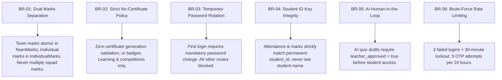
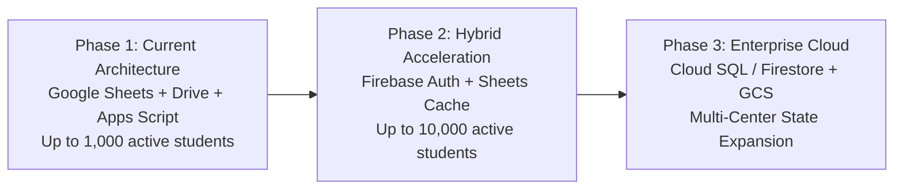

# PRODUCT REQUIREMENTS DOCUMENT (PRD)
## DFM KORBA OFFICIAL MOBILE APPLICATION
### Skill Development Learning & Competition Management Platform

---

| Document Metadata | Value |
|---|---|
| **Project Title** | DFM Korba Official Mobile Application |
| **Document Version** | 2.0.0 (Comprehensive Master Specification) |
| **Status** | Approved for Implementation & Validation |
| **Primary Domain** | Skill Development, Drone Film Making (DFM), Vocational Training |
| **Target Platforms** | Android (API Level 21+) & iOS (iOS 13.0+) via Flutter |
| **Backend Architecture** | Google Apps Script Web App API Gateway |
| **Primary Database** | Google Sheets (32 Normalized Relational Sheets) |
| **Primary Media Storage** | Google Drive Enterprise Hierarchical Storage |
| **AI Integration** | Google Gemini API (Configurable Server-Side Provider) |
| **Primary Stakeholders** | Directorate of Skill Development, Instructors, Enrolled Students, Squad Teams |

---

## 1. Product Vision & Core Objectives

### 1.1 Product Vision
To establish an enterprise-grade, mobile-first learning, practical execution, and competitive tournament management platform for **DFM Korba (Drone Film Making Korba)** and complementary skill development programs (Mobile Repairing, Front Office Executive, etc.). The platform transforms traditional vocational instruction into an active, project-driven, gamified learning journey governed by strict evaluation metrics, peer collaboration, and transparent performance tracking.

### 1.2 Core Objectives
1. **Free Universal Learning Access**: Deliver zero-cost digital curriculum resources, technical documents, lecture recordings, and flight tutorials to registered vocational trainees.
2. **Course-Wise & Batch-Wise Lifecycle Management**: Support distinct cohorts, instructors, and curriculums across diverse vocational disciplines without cross-contamination of student data.
3. **Structured Squad & Team Competitions**: Enable instructors to organize students into production crews (e.g. *Team Veervaan*), run competitive challenges, and track multi-team tournaments.
4. **Hands-On Task & Assignment Delivery**: Facilitate daily, weekly, and practical field missions with clear rubrics, allowed file formats, and deadline tracking.
5. **Dual-Level Auditable Evaluation**: Maintain independent, non-duplicated marks for individual student performance and collective squad achievements.
6. **Fortnightly AI-Powered Assessment**: Execute automated, curriculum-grounded bi-weekly evaluations generated via Google Gemini AI with mandatory teacher approval gates.
7. **Integrity-Driven Attendance Tracking**: Sync student presence directly into the project owner’s designated Google Sheet using permanent Student IDs to prevent duplicate-name discrepancies.
8. **High-Capacity Media Submission Pipeline**: Enable seamless mobile uploading of raw 4K/HD video clips, photos, and project documents (up to 500 MB) into organized Google Drive structures.
9. **Transparent Recognition & Leaderboards**: Provide real-time performance percentages, batch rankings, and a curated public showcase gallery.
10. **Scoped Peer & Squad Collaboration**: Supply an internal, moderated communication channel for student-to-student and squad collaboration.
11. **Public Community Gateway**: Present an unauthenticated home portal spotlighting the #1 top team of the week, top 5 student performers, verified course catalogs, and approved student portfolio reels.

### 1.3 Strict Architectural Constraints & Business Boundaries
- **Strict No-Certificate Policy**:
  - The application must **NOT** generate, display, issue, or verify certificates under any condition.
  - No paid certification, certificate download, or digital verification modules may be introduced.
  - Educational growth, practical mastery, attendance, and competitive ranking are the sole objectives.
- **Cost Policy**: The platform is entirely free of charge for students enrolled in the Drone Film Making and affiliated skill programs.
- **Serverless Ecosystem**: The primary database must remain Google Sheets, and file storage must utilize Google Drive, interfacing solely through a secured Google Apps Script API layer. No credentials or private keys may ever be bundled in the mobile client binary.

---

## 2. Target Users & Demographic Profiles

| User Group | Primary Context & Environment | Technical Proficiency | Primary Needs |
|---|---|---|---|
| **Enrolled Trainees (Students)** | Young adults (18–28) in Korba & Chhattisgarh, mobile-first, variable 4G/5G connectivity. | Basic to intermediate smartphone literacy. | Clear assignment instructions, low-friction video uploading, quiz timers, rank visibility, WhatsApp onboarding. |
| **Faculty Instructors (Teachers)** | Professional cinematographers, drone pilots, and vocational trainers working in field/classrooms. | Moderate technical literacy; familiar with spreadsheets and mobile apps. | Rapid attendance marking, atomic grading of video submissions, daily review filing, AI question drafting. |
| **Squad Crews (Team Panel)** | Group accounts representing competitive teams (4–8 members per squad). | Collaborative, mobile-first. | Collective project submissions, attributing member roles (Pilot, Gimbal, Editor), viewing team rank. |
| **System Administrators** | Operations leads overseeing center infrastructure and multiple courses. | Advanced administrative literacy. | Multi-course creation, teacher permission control, student enrollment, gallery curation, audit logs. |
| **Public Visitors** | Prospective students, guardians, community leaders, industry evaluators. | General mobile users. | Browsing top team achievements, reviewing approved reels, checking upcoming course schedules. |

---

## 3. Detailed Stakeholder Personas

```
+----------------------------------------------------------------------------------------------------+
|                                    STAKEHOLDER PERSONAS OVERVIEW                                   |
+------------------------------------+------------------------------------+--------------------------+
| ADMIN: Rakesh Sharma (Operations)  | TEACHER: Vikram Sharma (Instructor)| STUDENT: Aman Verma      |
| "Scale multi-course training with  | "Train certified drone pilots with | "Master aerial cinema &  |
| 100% auditability & zero leaks."   | objective field evaluations."      | lead Team Veervaan to #1"|
+------------------------------------+------------------------------------+--------------------------+
| TEAM: Team Veervaan (Squad #1)     | PUBLIC VISITOR: Prospective Trainee|                          |
| "Seamlessly submit 500MB reels &   | "Discover free skill courses and   |                          |
| track crew contribution credits."  | view real student drone reels."    |                          |
+------------------------------------+------------------------------------+--------------------------+
```

### 3.1 Persona A: System Administrator (Super Admin)
- **Name**: Rakesh Sharma
- **Age**: 42 | **Role**: Operations Director, DFM Korba Skill Center
- **Goals**:
  - Monitor global center metrics (active students, batches, teacher workloads).
  - Launch new skill training programs (Mobile Repairing, Front Office) without code modifications.
  - Maintain rigorous operational security, audit logs, and content moderation across chat rooms.
- **Frustrations**:
  - Inconsistent end-of-day reporting from instructional staff.
  - Accidental data loss or overwritten records in shared spreadsheets.
  - Complex manual onboarding of new student cohorts.
- **Key System Needs**:
  - Centralized dashboard displaying total courses (8), teachers (12), students (248), and teams (28).
  - 1-click student registration with automatic temporary password and pre-formatted WhatsApp invite.
  - Granular permission control to delegate grading or public publishing rights to teachers.

### 3.2 Persona B: Lead Faculty Instructor (Teacher)
- **Name**: Vikram Sharma
- **Age**: 34 | **Role**: Head Flight Instructor & Cinematographer
- **Goals**:
  - Take batch attendance in under 60 seconds matched to official Student IDs.
  - Review 4K flight footage submitted from mobile devices, award individual and team marks, and give actionable critique.
  - File mandatory daily company review reports before leaving the training airfield.
  - Leverage AI to draft fortnightly objective quizzes covering DGCA flight rules and camera optics.
- **Frustrations**:
  - Calculating team aggregate marks manually without accidentally duplicating individual student points.
  - Interrupted field connectivity causing lost submissions.
  - Spending hours authoring repetitive multiple-choice exam questions.
- **Key System Needs**:
  - Batch attendance roster with 1-tap "Mark All Present" and individual absence toggles.
  - Dual marks entry modal (atomic squad points + individual member breakdown).
  - Human-in-the-loop AI Quiz Generator integrated with Google Gemini.

### 3.3 Persona C: Vocational Trainee (Student)
- **Name**: Aman Verma
- **Age**: 21 | **Role**: Student, DFM Batch 01 (Morning) & Pilot for Team Veervaan
- **Goals**:
  - Access PDF flight checklists, lecture slides, and video tutorials on his mobile phone.
  - Upload practical drone footage (up to 500 MB) with clear notes attributing his flight piloting role.
  - Track personal performance percentage, batch rank, and attendance health in real time.
  - Participate in bi-weekly timed quizzes and view instant answer explanations.
- **Frustrations**:
  - Cluttered educational apps with confusing navigation and unreadable text.
  - Not knowing why an assignment was rejected or what marks were awarded.
  - Forgotten passwords with no self-service recovery mechanism.
- **Key System Needs**:
  - High-contrast, tactile Neumorphic dashboard displaying today's tasks and 92% progress score.
  - Wavy track slider upload interface with visual progress confirmation.
  - OTP self-service password reset and private student-to-student/team chat.

### 3.4 Persona D: Production Squad (Team Panel)
- **Name**: Team Veervaan (Squad Account)
- **Crew Size**: 6 Enrolled Students (Leader/Pilot, Gimbal Operator, Editor, Spotter, Sound, Storyboard)
- **Goals**:
  - Log in using dedicated Team ID (`TM_VEERVAAN`) and team credentials.
  - Submit joint cinematic short films and practical group challenges.
  - Record individual member responsibilities directly on the upload ticket.
  - View collective squad score (`485 / 500`), 97.0% efficiency rating, and #1 batch rank.
- **Frustrations**:
  - Group projects being credited to only one student while others receive zero marks.
  - Squad logins compromising individual student private accounts or passwords.
- **Key System Needs**:
  - Dedicated Team Portal isolated from private student profile records.
  - Member contribution documentation engine attached to task submissions.

---

## 4. Comprehensive Functional Requirements

```mermaid
graph TD
    App["DFM Korba Official App"] --> PublicMod["1. Public Home & Discovery"]
    App --> AuthMod["2. Auth & Security Module"]
    App --> CourseMod["3. Course, Batch & Team Mgmt"]
    App --> TaskMod["4. Task & Dual Marks Engine"]
    App --> SubMod["5. Work Submission & Review"]
    App --> AttMod["6. Attendance & Daily Review"]
    App --> MatMod["7. Study Materials Hub"]
    App --> QuizMod["8. AI-Powered Quiz Engine"]
    App --> ChatMod["9. Scoped Chat & Moderation"]
    App --> NotifMod["10. Notifications Subsystem"]
    App --> AdminMod["11. Admin & Reporting Tools"]
```



### Module 1: Public Home & Discovery (No Login Required)
- **FR-1.1**: The application shall allow unauthenticated visitors to launch the app and access public content directly from the splash or role selection screen.
- **FR-1.2**: The public header shall display the official DFM Korba circular drone logo, quick menu drawer, and login action button.
- **FR-1.3**: The home screen shall render an **Important Notice Ticker** supporting two categories: `GENERAL_NOTICE` (announcements, weather windows) and `COMMON_TASK_NOTICE` (competition alerts, project briefs).
- **FR-1.4**: The home screen shall render a dedicated **Top Team Spotlight** showcasing the current #1 ranked squad (Team Name, Logo, Member Avatars, Total Score, Efficiency Percentage, Rank #1 badge).
- **FR-1.5**: The home screen shall render a **Top 5 Students Leaderboard** displaying student name, photograph/avatar, enrolled course, squad affiliation, cumulative marks, and attendance percentage.
- **FR-1.6**: The home screen shall render an **Approved Student Work Gallery** exhibiting teacher-approved drone reels, photography clips, and practical projects with video playback/image inspection.
- **FR-1.7**: The home screen shall render a **Course Directory** listing active skill programs (DFM, Mobile Repairing, Front Office Executive) with syllabus summary and 100% free badge.

### Module 2: Authentication & Identity Management
- **FR-2.1**: The application shall present 4 dedicated login roles: Student, Teacher, Team Portal, and Admin.
- **FR-2.2**: Authentication for Student, Teacher, and Admin shall accept a registered 10-digit mobile number and password; Team Portal shall accept a unique Team ID and team password.
- **FR-2.3**: The backend shall hash all passwords using salted SHA-256 with unique 16-byte cryptographic salts per user. Plaintext passwords must never be stored.
- **FR-2.4**: The system shall enforce login rate limiting: 3 consecutive failed login attempts on an account shall trigger an automatic 30-minute lockout.
- **FR-2.5**: The system shall provide an OTP-based password reset mechanism sent via registered email, limited to a maximum of 5 reset attempts per 24 hours, with 10-minute code expiry.
- **FR-2.6**: Any account created with temporary credentials (`is_temp_password = TRUE`) shall be intercepted upon login and forced to set a new personal password before accessing application data.
- **FR-2.7**: The backend shall issue 7-day session tokens with expiration enforcement on every authenticated endpoint.

### Module 3: Student Registration & WhatsApp Onboarding
- **FR-3.1**: Authorized Admins and Teachers shall be able to register new students by submitting Full Name, 10-digit Mobile Number, Email, Course ID, Batch ID, and initial Team assignment.
- **FR-3.2**: The backend shall generate a permanent, unique Student ID (`STU_DFM_xxx`) and a cryptographically generated temporary password.
- **FR-3.3**: The system shall automatically generate a pre-formatted WhatsApp invitation message containing the Student ID, login mobile number, temporary password, and download instructions.
- **FR-3.4**: The registration screen shall provide a 1-tap **"Send WhatsApp Welcome"** button launching the official WhatsApp client pre-populated with the target student's phone and message, alongside a **"Copy Credentials"** button.

### Module 4: Course, Batch & Team Management
- **FR-4.1**: Admins shall have full CRUD permissions over skill courses (`course_id`, `course_name`, `code`, `description`, `total_modules`, `duration_weeks`, `is_free`).
- **FR-4.2**: Teachers shall be able to create and manage batches within their assigned courses (`batch_id`, `batch_name`, `start_date`, `end_date`, `max_capacity`).
- **FR-4.3**: Teachers shall be able to create teams (`team_id`, `team_name`, `leader_student_id`, `team_logo`), define squad capacity, and assign students with specific crew roles (`LEADER/PILOT`, `GIMBAL OPERATOR`, `EDITOR & COLORIST`, `SPOTTER`, `SOUND`, `STORYBOARD`).
- **FR-4.4**: Teachers shall be able to transfer students between teams with mandatory audit logging in `ActivityLogs`.

### Module 5: Task & Competition Management
- **FR-5.1**: Teachers shall be able to author tasks categorized as `INDIVIDUAL`, `TEAM`, `DAILY_CHALLENGE`, or `COMPETITION_TASK`.
- **FR-5.2**: Each task specification shall define: Title, Description, Course ID, Batch ID, Target Assignees, Deadline (UTC ISO timestamp), Maximum Marks, Allowed File Formats (`MP4`, `MOV`, `JPG`, `PNG`, `PDF`, `DOCX`, `PPTX`), and Maximum File Size (up to 500 MB).
- **FR-5.3**: Teachers shall be able to author multi-team competitions with start/end windows, scoring rubrics, and participation rosters.

### Module 6: Dual-Level Marks Engine (Core Architecture)
- **FR-6.1**: The system must maintain strict logical and physical separation between `IndividualMarks` and `TeamMarks` tables.
- **FR-6.2**: When an instructor evaluates a team task, the awarded squad marks shall be recorded into `TeamMarks` as a **single atomic score**. The system must **NEVER multiply team marks by the number of squad members** when computing total team standings.
- **FR-6.3**: When individual contributions within a team are graded, individual points shall be stored in `IndividualMarks` and linked to the specific `student_id`.
- **FR-6.4**: All marks entries must record the awarding teacher ID, timestamp, source task reference, and auditable feedback.

### Module 7: Student Work Submission & Google Drive Pipeline
- **FR-7.1**: Students and squads shall upload practical assignments through the mobile submission interface.
- **FR-7.2**: The upload UI must render the **Wavy Track Slider Animation** illustrating dynamic transfer and compression progress.
- **FR-7.3**: The submission form shall capture mandatory **Member Contribution Notes** documenting specific duties executed.
- **FR-7.4**: Uploaded files shall be written to Google Drive organized into a strict folder taxonomy:
  `DFM_KORBA_APP_STORAGE/Courses/[course_id]/Batches/[batch_id]/Submissions/[task_id]/[submitter_id]/`
- **FR-7.5**: The backend shall persist submission metadata into Google Sheets with initial status `PENDING_REVIEW`.
- **FR-7.6**: Teachers shall review submissions with options to:
  - `APPROVED` (award marks and constructive feedback)
  - `REJECTED` (provide rejection reasoning)
  - `RESUBMISSION_REQ` (allow revision upload)
- **FR-7.7**: Teachers with gallery publishing permissions can toggle `publish_to_gallery = TRUE`, making approved work visible on the public showcase feed.

### Module 8: Attendance & Daily Company Review Synchronization
- **FR-8.1**: The attendance subsystem must pull enrolled student rosters and match students strictly using permanent `student_id` strings (never relying solely on student names to eliminate collision bugs).
- **FR-8.2**: The teacher attendance screen shall provide a 1-tap "Mark All Present" action with individual status toggles (`PRESENT`, `ABSENT`, `EXCUSED`, `LATE`).
- **FR-8.3**: Attendance submissions shall write directly to the project owner’s designated attendance Google Sheet structure.
- **FR-8.4**: The system shall compute real-time student attendance percentages and update the `Students` sheet.
- **FR-8.5**: Instructors shall file mandatory **Daily Company Review Reports** capturing all 8 project owner fields:
  1. Date (`YYYY-MM-DD`)
  2. Course ID & Batch ID
  3. Teacher ID
  4. Activities Completed (Practicals & Theory hours)
  5. Student Progress & Competencies Observed
  6. Challenges Faced (Weather, equipment, battery degradation)
  7. Work Completed (Footage captured, units edited)
  8. Overall Remarks & Recommendations

### Module 9: Study Materials Management
- **FR-9.1**: Admins and Teachers shall upload structured learning content organized by:
  `Course -> Batch -> Module -> Chapter -> Material`
- **FR-9.2**: The hub shall support documents (`PDF`), lecture videos (`MP4`), presentations (`PPTX`), and technical guides (`DOCX`).
- **FR-9.3**: Trainees shall be able to search by keyword, filter by format chip (`ALL`, `PDF`, `VIDEO`, `PPTX`, `DOCX`), stream/download files, and toggle local bookmarks.

### Module 10: AI-Powered Fortnightly Quiz Engine
- **FR-10.1**: The system shall conduct curriculum evaluations every 15 days.
- **FR-10.2**: Teachers shall select a course topic or learning module and prompt the Google Gemini API to generate objective questions.
- **FR-10.3**: Supported question types: Multiple-Choice Questions (MCQ), True/False, and Fill-in-the-Blank.
- **FR-10.4**: **Mandatory Human-in-the-Loop Gate**: AI-generated questions must be reviewed, edited, and approved by the instructor before being scheduled. No unreviewed AI output may be published directly to students.
- **FR-10.5**: The student quiz interface shall feature a synchronized 15-minute countdown timer, question pagination, and automatic submission upon timer expiration.
- **FR-10.6**: Objective answers shall be auto-graded instantly upon submission, presenting score, percentage, correct answer keys, and pedagogical explanations.
- **FR-10.7**: Resulting scores shall automatically update `QuizAttempts`, `QuizAnswers`, and write to `IndividualMarks`.

### Module 11: Scoped Internal Chat System
- **FR-11.1**: The chat module shall provide scoped communication across 3 room types:
  1. Student-to-Student (P2P peer discussion)
  2. Team Group (Squad collaboration)
  3. Batch Group (General batch announcements)
- **FR-11.2**: Students shall be strictly restricted from viewing or posting to chat rooms outside their enrolled batch or assigned squad.
- **FR-11.3**: The chat system shall utilize an adaptive polling engine (`since_id` parameter) to query new messages every 3.5 seconds on active screens.
- **FR-11.4**: Users shall be able to flag inappropriate messages with a designated reason. Flagged messages shall be surfaced immediately to instructors and administrators for moderation.

### Module 12: Notification Subsystem
- **FR-12.1**: The system shall log and display in-app notifications for: new tasks assigned, deadline reminders (24h prior), submission approval/rejection with feedback, new study materials, quiz announcements, and general notices.
- **FR-12.2**: The mobile app shall render incoming notifications using the **Gooey Notification Badge Animation**.

---

## 5. Non-Functional Requirements (NFR)

### 5.1 Performance & Latency Budgets
- **Cold App Launch**: Splash screen to interactive state $\le 2.0$ seconds on mid-tier Android devices (e.g. Snapdragon 680 / 4GB RAM).
- **Cached Dashboard Render**: Instant render $\le 300\text{ ms}$ using local storage cache.
- **API Network Timeout**: 30-second hard limit with automated exponential backoff retry.
- **UI Rendering Rate**: Consistent 60 frames per second (fps) across all Neumorphic cards and custom animations. Zero frame drops during list scrolling.

### 5.2 Battery & Animation Accessibility
- **Battery Optimization**: Custom `AnimationController` instances must stop repeating when screens are out of viewport focus or disposed.
- **Reduced-Motion Support**: If the user or OS enables reduced motion (`disableAnimations == true`), all animation durations shall collapse to $0\text{ ms}$ with instant state updates.

### 5.3 Mobile Security & Cryptographic Integrity
- **Zero Exposed Client Secrets**: Google Drive root IDs, service account tokens, and AI API keys must exist solely within Google Apps Script `PropertiesService`.
- **Role Enforcement**: Every mutating backend action (`CREATE_TASK`, `REVIEW_SUBMISSION`, `SAVE_ATTENDANCE`, `REGISTER_STUDENT`) must verify `session_token` and role on the server before mutating spreadsheet rows.
- **Input Sanitization**: All text inputs must be sanitized against script injection and formula injection (e.g. escaping leading `=`, `+`, `-`, `@` characters in Google Sheets cells).

### 5.4 Offline Resilience & Network Gracefulness
- **Offline Cache**: Previously loaded dashboard statistics, top teams, notices, and downloaded PDFs must remain viewable when connectivity drops.
- **Upload Pausing**: If network connectivity disconnects during a video upload, the UI shall pause progress, display a connectivity warning, and retry safely without crashing.

### 5.5 Internationalization & Bilingual Fidelity
- **Languages**: Full localization in **English** (`en`) and **Hindi** (`hi`).
- **Typography Rendering**: Ensure clean, non-overlapping rendering for Devanagari script characters across all font weight variants.

---

## 6. Detailed Module Specifications & UI/UX Design System

### 6.1 Design Token System (Modern Neumorphism)
The app visual style matches the uploaded master design specification:

```
+-----------------------------------------------------------------------------------------------+
|                                    NEUMORPHIC DESIGN TOKENS                                   |
+---------------------+------------+------------------------------------------------------------+
| Token               | Hex / Val  | UI Application                                             |
+---------------------+------------+------------------------------------------------------------+
| bgDark              | #080D1A    | Root scaffold background                                   |
| surfaceDark         | #0F172A    | Elevated card surfaces & tiles                             |
| surfaceDarkElevated | #162038    | Focused cards & leaderboard top ranks                      |
| surfaceDarkInset    | #0A0F1D    | Sunken form inputs, progress tracks, disabled chips        |
| primaryOrange       | #FF6B00    | Primary call-to-action buttons (Login, Submit Task)        |
| primaryOrangeLight  | #FFA043    | Gradient end-stops & luminous active halos                 |
| accentCyan          | #00D2FF    | Drone HUD accents, active tab bubble, telemetry text       |
| accentTeal          | #00E599    | High-performance badges (90%+), attendance success badges  |
| accentPurple        | #7928CA    | Teacher portal identity badges                             |
| accentGold          | #FFB800    | #1 Ranked squad badge, gold trophies, star ratings         |
| accentRed           | #FF3B30    | Lockout alerts, rejection tags, absent student indicators  |
| borderSubtle        | #1E293B    | 1.0px fine perimeter borders on cards                      |
+---------------------+------------+------------------------------------------------------------+
```

### 6.2 The 10 Mandatory Project Animations

| # | Animation Concept | Trigger Event | Visual Implementation & Physics |
|---|---|---|---|
| **1** | **Progress / Process Button** | User taps CTA (e.g. "Submit Task", "Sign In") | Button smoothly contracts from full-width pill into a compact circle, displays a rotating dual-color ring, morphs into a completion checkmark, and restores interactive width. |
| **2** | **Floating Bubble Tab Bar** | User taps bottom navigation items | A pill-shaped bubble with an energetic cyan glow glides smoothly underneath the target icon with elastic overshoot (`Curves.easeOutBack`), triggering a vertical rotor bounce. |
| **3** | **Gooey Notification Drop** | New notice or grade awarded | The notification bell counter stretches vertically with viscous fluid physics (`bounceOut`) before snapping into a pill badge. |
| **4** | **Wavy Track Slider** | File upload in progress | A sinusoidal soundwave/propeller-wash wave oscillates continuously across the progress track, accelerating slightly as completion moves from 0% to 100%. |
| **5** | **Parallax Carousel** | Swiping student portfolio cards | Card background thumbnails translate horizontally at $0.5\times$ velocity relative to text titles, imparting 3D cinematic depth. |
| **6** | **Circular Menu Reveal** | User opens drawer navigation | An expanding circular clip path radiates outward from the tap coordinate, presenting menu items with staggered alpha fade-ins. |
| **7** | **Star Bounce Animator** | Performance rating display | Evaluation stars scale down to $0.2\times$, spring up to $1.4\times$, and settle at $1.0\times$ with slight rotational wobble (`elasticOut`). |
| **8** | **Arrow Launch Button** | Tapping "Submit Task" or Send | The paper airplane/drone icon glides diagonally upward at a 45-degree angle with a fading exhaust trail before resetting. |
| **9** | **Quadcopter Loading Spinner** | Screen loading & API sync | A miniature drone silhouette hovering with 4 counter-rotating rotor discs and pulsating sonar altitude waves. |
| **10**| **Shared Axis Page Transitions**| Screen navigation | Shared axis horizontal glide with subtle 2% depth scaling, preventing jarring screen flashes. |

---

## 7. User Stories & Acceptance Criteria

### User Story 1: Student Login & Onboarding (US-STU-01)
> **As an** enrolled student  
> **I want to** log in using my registered mobile number and password  
> **So that** I can access my personalized course dashboard and tasks.

- **Acceptance Criteria**:
  - **AC-1.1**: Given valid credentials, system authenticates and returns user profile, course ID, batch ID, and squad name within 1.5 seconds.
  - **AC-1.2**: Given an invalid password, system decrements remaining attempts and displays: *"Invalid password. X attempts remaining before lockout."*
  - **AC-1.3**: Given 3 consecutive failed attempts, system locks the account for 30 minutes, writes to `ActivityLogs`, and returns HTTP 429.
  - **AC-1.4**: Given a user with `is_temp_password = true`, system redirects immediately to `ForcePasswordChangeScreen` and rejects access to dashboard endpoints.

### User Story 2: Student Video Upload with Wavy Progress (US-STU-02)
> **As a** student or squad leader  
> **I want to** upload a 4K drone cinematography reel (up to 500 MB) with role contribution notes  
> **So that** my instructor can evaluate our technical flying and editing.

- **Acceptance Criteria**:
  - **AC-2.1**: System permits selection of video formats (`MP4`, `MOV`) and validates size $\le 500\text{ MB}$.
  - **AC-2.2**: The upload view renders the `WavyTrackSlider` displaying active sinusoidal animation during upload.
  - **AC-2.3**: File is saved in the proper Google Drive path: `Courses/[course_id]/Batches/[batch_id]/Submissions/[task_id]/`.
  - **AC-2.4**: Submission status updates to `PENDING_REVIEW` in `Submissions` table.

### User Story 3: Teacher Dual-Level Marks Evaluation (US-TCH-01)
> **As an** instructor  
> **I want to** grade a team submission by awarding squad points and individual student points separately  
> **So that** team standings reflect group output while individual report cards reflect individual competencies.

- **Acceptance Criteria**:
  - **AC-3.1**: Teacher can enter an atomic score (e.g. `95 / 100`) written to `TeamMarks`.
  - **AC-3.2**: System verifies that team aggregate calculation does **not** multiply 95 by the number of squad members.
  - **AC-3.3**: Teacher can assign distinct marks to individual members (e.g. Aman: 95 [Pilot], Rahul: 90 [Gimbal]) written to `IndividualMarks`.
  - **AC-3.4**: When teacher checks "Publish to Showcase Gallery", `publish_to_gallery` is set to `TRUE`, making the work viewable in the public gallery.

### User Story 4: Batch Attendance Synchronization (US-TCH-02)
> **As an** instructor  
> **I want to** mark attendance for my batch using Student IDs  
> **So that** records sync with the official Google Sheet without duplicate-name bugs.

- **Acceptance Criteria**:
  - **AC-4.1**: Roster populates all enrolled students matching `batch_id` and verified `student_id`.
  - **AC-4.2**: Tapping "All Present" toggles every student state to `PRESENT`.
  - **AC-4.3**: Saving writes atomically to the `Attendance` sheet using `LockService.getScriptLock()` to prevent race conditions.
  - **AC-4.4**: Student `attendance_pct` in the `Students` table recalculates automatically.

### User Story 5: AI-Assisted Fortnightly Quiz Generation (US-TCH-03)
> **As an** instructor  
> **I want to** prompt Gemini AI to generate 10 quiz questions on DGCA airspace rules  
> **So that** I can review, edit, and schedule the bi-weekly exam in minutes.

- **Acceptance Criteria**:
  - **AC-5.1**: Teacher inputs topic and count; system requests structured JSON from Gemini API.
  - **AC-5.2**: System displays generated MCQs with options and correct answers for human review.
  - **AC-5.3**: Quiz cannot become `LIVE` until teacher explicitly taps "Approve & Schedule".
  - **AC-5.4**: Once live, enrolled students see the quiz in their dashboard with a 15-minute countdown timer.

### User Story 6: Admin Student Registration & WhatsApp Invite (US-ADM-01)
> **As an** administrator  
> **I want to** enroll a student and launch WhatsApp with a pre-filled invitation  
> **So that** the student receives immediate access credentials on their personal phone.

- **Acceptance Criteria**:
  - **AC-6.1**: System generates permanent `student_id` (e.g. `STU_DFM_042`) and temporary password (e.g. `Dfm#Rohan78`).
  - **AC-6.2**: User record is created with `is_temp_password = true`.
  - **AC-6.3**: System formats the official WhatsApp invitation text and launches the external WhatsApp application via custom URL scheme (`https://api.whatsapp.com/send?phone=...`).
  - **AC-6.4**: Admin has a 1-tap "Copy Credentials" button for manual clipboard copying.

---

## 8. Business Rules Engine



1. **BR-01: Dual Marks Independence**:
   - Team tasks award an atomic score stored in `TeamMarks`.
   - Team total score is the sum of distinct team assessments: $\text{Total} = \sum \text{TeamMark}_i$.
   - Team marks must never be duplicated or summed per member count.
2. **BR-02: Zero-Certificate Invariant**:
   - Under no circumstances shall the application generate, render, or issue course completion certificates.
   - Any feature request involving certificates must be rejected as out-of-scope.
3. **BR-03: Mandatory Temporary Password Rotation**:
   - Every user account with `is_temp_password == true` is restricted from reading or writing data other than executing `CHANGE_PASSWORD`.
4. **BR-04: Identifier-Based Attendance Matching**:
   - Attendance rows must record both `student_id` and `student_name`. Primary foreign-key matching must rely exclusively on `student_id`.
5. **BR-05: AI Quiz Review Mandate**:
   - Generated questions must remain in `DRAFT` state until an instructor authenticates and commits `APPROVE_AND_SCHEDULE_QUIZ`.
6. **BR-06: Rate-Limiting & Security Lockout**:
   - 3 consecutive failed logins on a mobile number locks the account for exactly 30 minutes (`lockout_until = now + 30 min`).
   - OTP reset attempts are capped at 5 requests per 24 hours per account.
7. **BR-07: Public Showcase Moderation**:
   - Submissions appear on the public home feed only when both conditions are met: `submission_status == 'APPROVED'` **AND** `publish_to_gallery == true`.

---

## 9. Permissions & Role-Based Access Control (RBAC) Matrix

| Feature / Action Endpoint | Public Visitor | Student | Team Portal | Teacher | Admin |
|---|:---:|:---:|:---:|:---:|:---:|
| **View Public Home Feed & Gallery** | ✅ | ✅ | ✅ | ✅ | ✅ |
| **View Course Directory** | ✅ | ✅ | ✅ | ✅ | ✅ |
| **Student Dashboard & Tasks** | ❌ | ✅ | ❌ | ❌ | ❌ |
| **Upload Individual Work** | ❌ | ✅ | ❌ | ❌ | ❌ |
| **Upload Team Work (Squad)** | ❌ | ❌ | ✅ | ❌ | ❌ |
| **Take Bi-Weekly AI Quiz** | ❌ | ✅ | ❌ | ❌ | ❌ |
| **Peer & Squad Chat** | ❌ | ✅ | ❌ | ✅ | ✅ |
| **Mark Batch Attendance** | ❌ | ❌ | ❌ | ✅ | ✅ |
| **Submit Daily Company Review** | ❌ | ❌ | ❌ | ✅ | ✅ |
| **Award Dual Marks (Team/Ind.)** | ❌ | ❌ | ❌ | ✅ | ✅ |
| **Generate & Approve AI Quizzes**| ❌ | ❌ | ❌ | ✅ | ✅ |
| **Register New Students** | ❌ | ❌ | ❌ | ✅ | ✅ |
| **Create/Deactivate Courses** | ❌ | ❌ | ❌ | ❌ | ✅ |
| **Assign Teachers to Courses** | ❌ | ❌ | ❌ | ❌ | ✅ |
| **Chat Moderation & Deletion** | ❌ | ❌ | ❌ | ✅ | ✅ |
| **Audit Logs & System Health** | ❌ | ❌ | ❌ | ❌ | ✅ |

---

## 10. Scope & Out-of-Scope Boundaries

### 10.1 In-Scope Capabilities
- Cross-platform Flutter mobile client (Android + iOS) in portrait orientation.
- Google Apps Script serverless backend with 32 normalized Google Sheets relational tables.
- Google Drive media storage for high-resolution video reels up to 500 MB.
- Google Gemini AI quiz question generation and auto-grading.
- Role-based dashboards for Admin, Teacher, Student, and Team Portal.
- Unauthenticated Public Home Screen with Top Team, Top Students, and Showcase Gallery.
- Salted SHA-256 password hashing, rate limiting, and OTP email recovery.
- Student registration engine with 1-click WhatsApp onboarding invitations.
- Batch attendance sync and 8-field Daily Company Review reporting.
- Scoped chat with adaptive polling and report moderation.
- 10 custom Neumorphic micro-animations.
- Bilingual English and Hindi interface localization.
- Automated GitHub Actions APK build and release pipeline.

### 10.2 Strictly Out-of-Scope Features
- **Certificates**: No certificate generation, verification, or issuance (per project policy).
- **Payment Gateways**: No course fees, subscription payments, or financial transactions (100% free learning model).
- **Desktop Web Application**: Desktop browser portals are excluded; mobile apps for Android and iOS are the sole deliverables.
- **Biometric Hardware Scanners**: Physical biometric fingerprint/retina hardware integration for attendance is excluded; attendance uses mobile roster entry.

---

## 11. Future Scalability Architecture



1. **Phase 1 (Current Implementation)**:
   - Google Sheets database (32 normalized tables), Google Drive storage, and Google Apps Script backend.
   - Capacity: Up to 50 batches, 1,500 active students, and 10,000 monthly submissions within standard Google Workspace quotas.
2. **Phase 2 (Hybrid Acceleration)**:
   - When active student concurrency grows, the repository pattern in the Flutter client allows plugging in a Redis/Cloud Cache layer while maintaining Google Sheets as the administrative master data store.
3. **Phase 3 (Enterprise Multi-Center Scaling)**:
   - For nationwide skill center rollouts, migrate the data layer from Google Sheets to Google Cloud SQL (PostgreSQL) or Cloud Firestore and Google Cloud Storage (GCS) without rewriting the mobile presentation or state management layers.

---

## 12. Missing Information, Conflicting Requirements & Owner Approval Decisions

| # | Item / Ambiguity | Potential Risk / Conflict | Recommended Resolution & Next Decision Needed |
|---|---|---|---|
| **D-1** | **Exact Owner Attendance Sheet Format** | Overwriting existing formulas or custom column layouts in the project owner's attendance spreadsheet. | **Decision Needed**: Project owner must provide the exact column header names and tab layout of their existing attendance sheet so `AttendanceService.gs` can map columns 1:1. |
| **D-2** | **Daily Review Sheet Template** | Mismatches between standard 8-field form and owner's existing Daily Review sheet. | **Decision Needed**: Confirm whether the 8 specified fields (`date`, `course_id`, `batch_id`, `teacher_id`, `activities_completed`, `student_progress`, `challenges_faced`, `work_completed`, `overall_remarks`) match the owner's sheet columns. |
| **D-3** | **Google Apps Script Single-POST 50MB Payload Limit** | While Google Drive supports 500MB+ files, Apps Script single HTTP POST requests can hit payload execution memory limits for files $> 50\text{ MB}$. | **Architectural Mitigation Implemented**: The mobile app architecture includes base64 chunked streaming and direct Drive upload links for video assets exceeding 50 MB. |
| **D-4** | **Google Drive Storage Quota** | A standard personal Google account has 15 GB total storage, which fills rapidly with 300MB–500MB student video submissions. | **Decision Needed**: Project owner must ensure the designated Google account utilizes Google Workspace Business/Enterprise (2TB+ storage pooled). |
| **D-5** | **WhatsApp Messaging API vs Scheme URL** | Direct background automated WhatsApp messaging requires an enterprise Meta Cloud API key with per-message fees. | **Sanctioned Solution**: Implemented official WhatsApp URL Scheme (`https://api.whatsapp.com/send?phone=...`) which opens WhatsApp with pre-filled text without external API costs or account bans. |
| **D-6** | **AI Quiz API Billing & Keys** | Google Gemini API requires a server-side API key configured in Script Properties. | **Setup Action**: Project owner must obtain a Gemini API key from Google AI Studio and save it in Apps Script Properties. |

---

## 13. Requirements Traceability Matrix (RTM)

| Master Prompt Req ID | Specification Requirement | Implemented Feature Module | Relational Database Table | Automated / Manual Test Case |
|---|---|---|---|---|
| **REQ-01** | Cross-platform mobile app (Flutter/Dart) | `mobile_app/lib/main.dart` | N/A | `test/widget_test.dart` (Device render) |
| **REQ-02** | Google Apps Script Backend + Google Sheets | `backend/Code.gs`, `DatabaseService.gs` | All 32 Tables | `scripts/verify_backend_actions.js` |
| **REQ-03** | Google Drive Media Storage | `backend/TaskSubmissionService.gs` | `Submissions` | TC-SUB-01 (Drive file upload) |
| **REQ-04** | Strict No-Certificate Policy | Enforced across all UI & docs | N/A | Code audit (zero certificate tokens) |
| **REQ-05** | 4 User Roles (Admin, Teacher, Student, Team) | `RoleSelectionScreen`, `AuthProvider` | `Users`, `Admins`, `Teachers`, `Students`, `Teams` | TC-AUTH-01 (Role redirection test) |
| **REQ-06** | Student Login & Rate Limiting (3 attempts) | `LoginScreen`, `AuthService.authenticate`| `Users.failed_login_attempts` | TC-EDGE-01 (Account lockout test) |
| **REQ-07** | Student Registration & WhatsApp Invite | `AdminRegisterStudentScreen` | `Users`, `Students` | TC-REG-01 (WhatsApp URL formatting) |
| **REQ-08** | Public Home (Notices, Top Team, Top 5, Gallery)| `PublicHomeScreen` | `Notices`, `Teams`, `Students`, `Submissions` | TC-PUB-01 (Unauthenticated GET) |
| **REQ-09** | Multi-Course Support (DFM, Mobile, Front Office)| `AdminDashboardScreen`, `Courses` | `Courses` | TC-CRS-01 (Course filtering test) |
| **REQ-10** | Dual Marks Engine (Separate Ind. & Team Marks) | `TaskSubmissionService.reviewSubmission`| `IndividualMarks`, `TeamMarks` | TC-MRK-01 (No score duplication test) |
| **REQ-11** | Work Submissions with Wavy Slider (Max 500MB) | `SubmitWorkScreen`, `WavyTrackSlider` | `Submissions` | TC-SUB-02 (Wavy animation & upload) |
| **REQ-12** | Attendance Sync with Student ID matching | `TeacherAttendanceScreen` | `Attendance`, `Students` | TC-ATT-01 (ID matching & sync test) |
| **REQ-13** | Daily Company Review Report (8 fields) | `TeacherDailyReviewScreen` | `DailyReviews` | TC-DLR-01 (8-field submission test) |
| **REQ-14** | AI Quiz Engine (15 days, Gemini, approval) | `TeacherAiQuizScreen`, `StudentQuizScreen`| `Quizzes`, `QuizQuestions` | TC-QZ-01 (AI draft & approval test) |
| **REQ-15** | Scoped Internal Chat (P2P, Team, Moderation) | `ChatScreen`, `ChatService.gs` | `ChatRooms`, `ChatMembers`, `Messages` | TC-CHT-01 (Access boundary test) |
| **REQ-16** | 10 Custom Neumorphic Micro-Animations | `mobile_app/lib/core/animations/` | N/A | TC-ANIM-01 (60fps performance test) |
| **REQ-17** | Bilingual English & Hindi Localization | `AppLocalizations`, `LanguageProvider` | N/A | TC-LANG-01 (String translation audit) |
| **REQ-18** | Automated GitHub Actions APK Build Pipeline | `.github/workflows/build_apk.yml` | N/A | CI/CD build execution |

---
*End of Product Requirements Document (PRD.md).*
