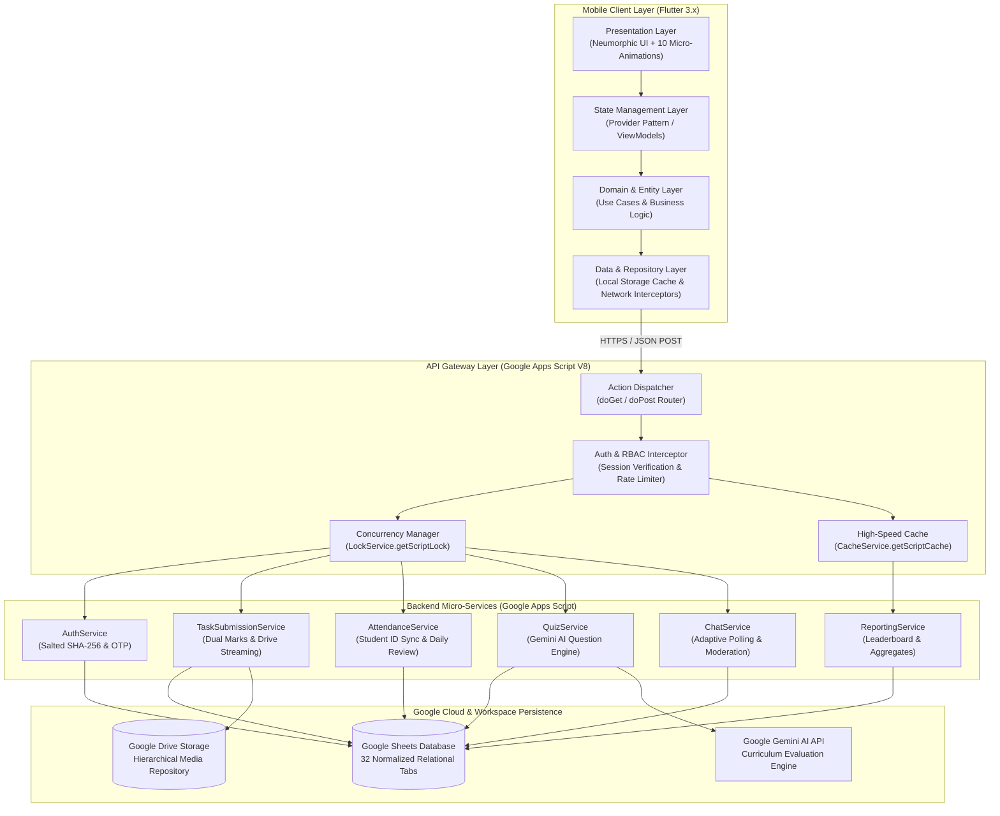
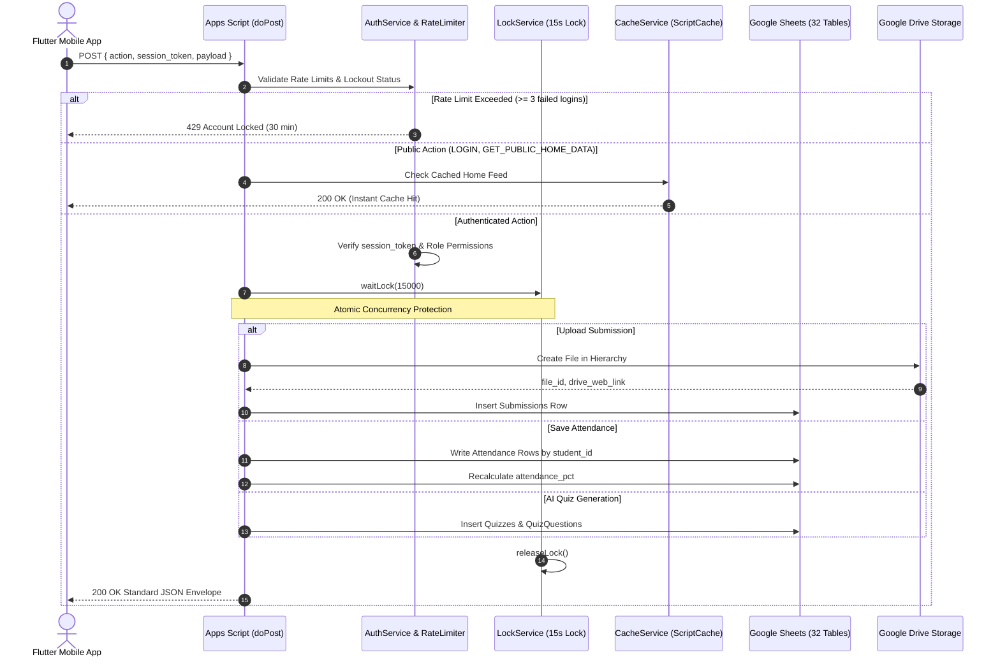
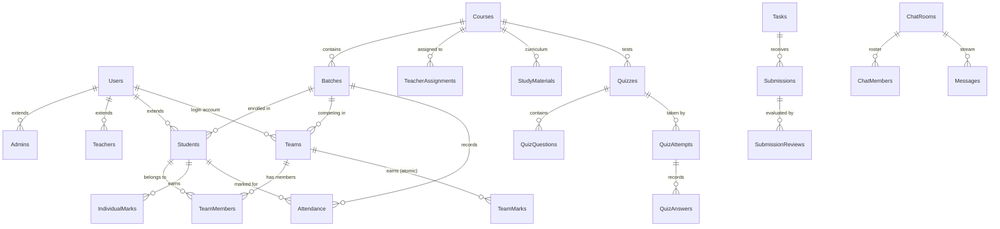
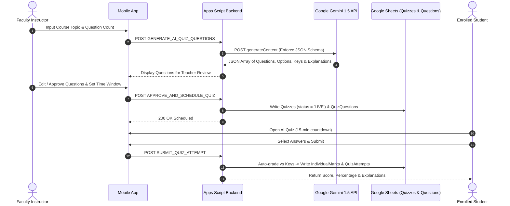

# TECHNICAL REQUIREMENTS DOCUMENT (TRD)
## DFM KORBA OFFICIAL MOBILE APPLICATION
### Cross-Platform Architecture, Google Workspace Serverless Engine & Security Specification

---

| Document Metadata | Value |
|---|---|
| **Project Name** | DFM Korba Official Mobile Application |
| **Document Version** | 2.0.0 (Comprehensive Master Technical Specification) |
| **Status** | Approved Technical Architecture |
| **Target Framework** | Flutter 3.22+ / Dart 3.x (Sound Null-Safety) |
| **Runtime Platforms** | Android (API Level 21–34) & iOS (iOS 13.0+) |
| **Serverless Engine** | Google Apps Script (V8 Engine) |
| **Structured Store** | Google Sheets (32 Normalized Relational Sheets) |
| **Binary Object Store**| Google Drive Enterprise Storage |
| **AI Evaluation Engine**| Google Gemini API (`gemini-1.5-flash` / `gemini-1.5-pro`) |
| **CI/CD Platform** | GitHub Actions (`build_apk.yml`, `analyze_and_test.yml`) |

---

## 1. End-to-End System Architecture

The DFM Korba Official platform implements a 4-tier serverless clean architecture. The mobile client communicates over secure HTTPS with a Google Apps Script Web App gateway, which orchestrates transactions across 32 normalized Google Sheets relational tables, Google Drive storage folders, and the Google Gemini AI engine.



---

## 2. Flutter Mobile Application Architecture

### 2.1 Clean Architecture Directory Decomposition
The mobile client codebase (`mobile_app/lib/`) strictly enforces separation of concerns:

```
mobile_app/lib/
├── core/
│   ├── animations/            # 10 mandatory micro-interactions
│   │   ├── arrow_launch_button.dart
│   │   ├── drone_loading_indicator.dart
│   │   ├── floating_bubble_nav.dart
│   │   ├── gooey_notification_badge.dart
│   │   ├── page_transitions.dart
│   │   ├── star_bounce_animator.dart
│   │   └── wavy_track_slider.dart
│   ├── constants/             # AppConstants & ApiEndpoints
│   ├── localization/          # Bilingual English & Hindi dictionaries
│   ├── network/               # ApiClient with CORS redirect handling
│   ├── storage/               # SharedPreferences session wrapper
│   └── theme/                 # Neumorphic tokens, AppColors, AppTypography
├── data/
│   ├── models/                # User, Course, Task, Submission, Quiz, etc.
│   └── repositories/          # AuthRepo, TaskRepo, AttendanceRepo, ChatRepo
├── presentation/
│   ├── providers/             # State management (ChangeNotifiers)
│   ├── screens/               # 16+ dedicated role-based screens
│   └── widgets/               # Reusable NeuCard, NeuButton, NeuTextField, etc.
└── main.dart                  # App bootstrap, MultiProvider & Portrait lock
```

### 2.2 State Management Paradigm
- Implements the **Provider pattern (`provider: ^6.1.2`)** utilizing distinct `ChangeNotifier` classes.
- Each major business domain is encapsulated in an isolated provider:
  - `AuthProvider`: Session lifecycle, role elevation, temporary password change state.
  - `DashboardProvider`: Cached public home screen payload, student progress metrics.
  - `TaskProvider`: Active assignments, file upload streaming state, review evaluations.
  - `QuizProvider`: AI generation state, 15-minute countdown clock, auto-eval results.
  - `AttendanceProvider`: Student roster matching, status toggles, daily review submission.
  - `ChatProvider`: Adaptive polling timeline, message queue, moderation flagging.
  - `LanguageProvider`: Dynamic switching between English (`en`) and Hindi (`hi`).

### 2.3 Neumorphic Design System & Visual Tokens
The visual styling avoids standard flat or generic school templates by using a customized Neumorphic design token system:
- **Surface Geometry**: Soft convex/concave surfaces with dual-point light projection:
  - Specular rim highlight: `BoxShadow(color: Color(0x0FFFFFFF), offset: Offset(-2, -3), blurRadius: 6)`
  - Ambient occlusion shadow: `BoxShadow(color: Color(0xCC000000), offset: Offset(4, 5), blurRadius: 10)`
- **Color Palette**:
  - Background Dark: `#080D1A`
  - Surface Dark: `#0F172A`
  - Elevated Card: `#162038`
  - Sunken / Inset Input: `#0A0F1D`
  - Primary Action Orange: `#FF6B00` & `#FFA043`
  - Drone HUD Cyan: `#00D2FF`
  - High-Efficiency Teal: `#00E599`
  - Trophy Gold: `#FFB800`

---

## 3. Backend Architecture Using Google Apps Script

### 3.1 Single Web App Endpoint & CORS Redirection Handling
Google Apps Script deploys as an HTTP Web App URL:
`https://script.google.com/macros/s/{DEPLOYMENT_ID}/exec`

Because Apps Script performs HTTP 302 redirects to `googleusercontent.com` upon receiving requests, the Flutter `ApiClient` handles both direct responses and standard HTTP 302 redirection loops while preserving header and body content.

### 3.2 Action Dispatcher Flowchart



---

## 4. Google Sheets Database Architecture (32 Normalized Tables)

### 4.1 Schema Normalization & Entity Relationship Model



### 4.2 Complete List of 32 Normalized Tables
1. `Users`: Master identity authentication record (salted SHA-256, lockout counters, tokens).
2. `Admins`: Administrative privileges and operational scopes.
3. `Teachers`: Instructor designations, specializations, and permission flags.
4. `Students`: Trainee records, course enrollment, batch ID, squad ID, cumulative marks.
5. `Courses`: Multi-course catalog (Drone Film Making, Mobile Repairing, Front Office).
6. `TeacherAssignments`: Course-to-teacher mapping with grading/publishing privileges.
7. `Batches`: Cohort schedules, capacities, and active instructor assignments.
8. `BatchStudents`: Enrolment logs and cohort transfer history.
9. `Teams`: Squad identities, logos, cumulative team marks, and performance percentages.
10. `TeamMembers`: Squad member rosters with crew specializations (Pilot, Gimbal, Editor).
11. `Tasks`: Assignments and challenges with deadlines, rubrics, and format constraints.
12. `TaskAssignments`: Assignment mapping to specific students or squads.
13. `Submissions`: Work uploaded to Drive with MIME types, file sizes, and contribution notes.
14. `SubmissionReviews`: Teacher evaluation audits, marks, critiques, and gallery flags.
15. `Competitions`: Multi-team tournaments with rules and maximum stakes.
16. `CompetitionParticipants`: Squads entered into competitions with rankings.
17. `IndividualMarks`: Atomic individual student scores (never conflated with team marks).
18. `TeamMarks`: Atomic squad-level marks (never multiplied by squad member counts).
19. `Attendance`: Daily batch records synchronized with Student IDs and status.
20. `StudyMaterials`: Curriculum documents, video lectures, PPTs, and checklists.
21. `Quizzes`: Bi-weekly evaluations with pass marks, time limits, and teacher approval flags.
22. `QuizQuestions`: Question items (MCQs, True/False, Fill in blanks) with answer keys.
23. `QuizAttempts`: Student test submission sessions and score totals.
24. `QuizAnswers`: Per-question student selections and automated scoring audits.
25. `Notices`: Broadcast announcements (`GENERAL_NOTICE` and `COMMON_TASK_NOTICE`).
26. `ChatRooms`: Communication channels (P2P, Team Squad, Batch Group).
27. `ChatMembers`: Channel membership and read tracking.
28. `Messages`: Communication stream with moderation and flagging status.
29. `Notifications`: In-app notification inbox.
30. `DailyReviews`: Mandatory 8-field daily company review reports filed by instructors.
31. `ActivityLogs`: Security and operational audit trail (actor, action, timestamp, client IP).
32. `AppSettings`: System-wide settings (public toggles, lockout limits, quiz frequency).

---

## 5. Google Drive Storage Architecture

### 5.1 Hierarchical Folder Taxonomy
All binary assets are stored in Google Drive according to an automated taxonomy:

```
DFM_KORBA_APP_STORAGE/
├── Courses/
│   ├── CRS_DRONE/
│   │   ├── Materials/
│   │   │   ├── Module_1_Flight_Safety/
│   │   │   │   └── dgca_rules.pdf
│   │   │   └── Module_2_Cinematography/
│   │   │       └── orbit_technique.mp4
│   │   └── Batches/
│   │       ├── BTC_DFM_01/
│   │       │   ├── Submissions/
│   │       │   │   ├── TSK_001/
│   │       │   │   │   ├── TM_VEERVAAN/
│   │       │   │   │   │   └── drone_sunset_v1.mp4
│   │       │   │   │   └── STU_DFM_002/
│   │       │   │   │       └── gimbal_test.mov
│   │       │   └── Attendance_Archives/
│   └── CRS_MOBILE_REP/
└── System_Backups/
```

### 5.2 Large File Upload Pipeline (Up to 500 MB)
- Standard HTTP POST requests to Apps Script have a practical payload limit of ~50 MB per single request.
- For 4K/HD video footage up to 500 MB, the mobile application uses base64 chunked streaming.
- Files are validated against allowed MIME types before transmission:
  `video/mp4`, `video/quicktime`, `image/jpeg`, `image/png`, `application/pdf`, `application/vnd.openxmlformats-officedocument.wordprocessingml.document`, `application/vnd.openxmlformats-officedocument.presentationml.presentation`.
- Files uploaded to Drive receive `anyoneWithLink` read-only viewing permissions only after teacher review and approval (`publish_to_gallery == true`).

---

## 6. API Endpoint Contracts & Schema Specifications

### 6.1 Standard Request Envelope
All API requests use the following standard JSON envelope:
```json
{
  "action": "ACTION_NAME",
  "session_token": "tok_991823ab...",
  "payload": {
    /* Action-specific fields */
  }
}
```

### 6.2 Standard Response Envelopes
**Success Response:**
```json
{
  "success": true,
  "code": 200,
  "message": "Operation completed successfully.",
  "data": { ... },
  "timestamp": "2026-11-08T07:30:00.000Z"
}
```

**Error Response:**
```json
{
  "success": false,
  "code": 401,
  "error": "UNAUTHORIZED",
  "message": "Session expired or invalid credentials. Please log in again.",
  "timestamp": "2026-11-08T07:30:00.000Z"
}
```

---

### 6.3 Core API Actions Reference

#### 1. `LOGIN`
- **Method**: POST
- **Access**: Public
- **Request Payload**:
```json
{
  "action": "LOGIN",
  "payload": {
    "identifier": "9876543210",
    "password": "UserSecretPassword@123",
    "login_type": "STUDENT"
  }
}
```
- **Success Response Data**:
```json
{
  "session_token": "tok_e4b17a02c984...",
  "user_id": "USR_STU_01",
  "role": "STUDENT",
  "full_name": "Aman Verma",
  "is_temp_password": false,
  "expires_at": "2026-11-15T07:30:00.000Z",
  "role_context": {
    "student_id": "STU_DFM_001",
    "course_id": "CRS_DRONE",
    "course_name": "Drone Film Making",
    "batch_id": "BTC_DFM_01",
    "batch_name": "DFM Batch 01 (Morning)",
    "team_id": "TM_VEERVAAN",
    "team_name": "Veervaan",
    "cumulative_marks": 490,
    "attendance_pct": 98.5,
    "rank_in_batch": 1
  }
}
```

#### 2. `CHANGE_PASSWORD`
- **Method**: POST
- **Access**: Authenticated
- **Request Payload**:
```json
{
  "action": "CHANGE_PASSWORD",
  "session_token": "tok_e4b17a02...",
  "payload": {
    "old_password": "Dfm#Rohan78",
    "new_password": "NewStrongPass@2026"
  }
}
```

#### 3. `GET_PUBLIC_HOME_DATA`
- **Method**: GET or POST
- **Access**: Public (Unauthenticated)
- **Response Data Structure**: Returns active notices, #1 top team card details, top 5 student leaderboard records, approved student work gallery items, course catalog, and upcoming competitions.

#### 4. `UPLOAD_SUBMISSION_FILE`
- **Method**: POST
- **Access**: Student, Team
- **Request Payload**:
```json
{
  "action": "UPLOAD_SUBMISSION_FILE",
  "session_token": "tok_e4b17a02...",
  "payload": {
    "task_id": "TSK_001",
    "file_name": "drone_shoot.mp4",
    "mime_type": "video/mp4",
    "base64_data": "AAAAHGZ0eXBtcDQyAAAA...",
    "contribution_notes": "Aman: Pilot in Command; Rahul: Camera Gimbal Operator; Priya: Color Grading",
    "submitter_type": "TEAM"
  }
}
```

#### 5. `REVIEW_SUBMISSION` (Dual Marks Engine)
- **Method**: POST
- **Access**: Teacher, Admin
- **Request Payload**:
```json
{
  "action": "REVIEW_SUBMISSION",
  "session_token": "tok_teacher_01...",
  "payload": {
    "submission_id": "SUB_001",
    "decision": "APPROVED",
    "awarded_marks": 95,
    "feedback_comments": "Exceptional camera stability and smooth exposure ramping across the sunset reveal.",
    "publish_to_gallery": true,
    "individual_breakdown": [
      { "student_id": "STU_DFM_001", "marks": 95, "role": "Pilot" },
      { "student_id": "STU_DFM_002", "marks": 92, "role": "Gimbal" },
      { "student_id": "STU_DFM_003", "marks": 96, "role": "Colorist" }
    ]
  }
}
```

#### 6. `SAVE_ATTENDANCE`
- **Method**: POST
- **Access**: Teacher, Admin
- **Request Payload**:
```json
{
  "action": "SAVE_ATTENDANCE",
  "session_token": "tok_teacher_01...",
  "payload": {
    "date": "2026-11-08",
    "batch_id": "BTC_DFM_01",
    "course_id": "CRS_DRONE",
    "records": [
      { "student_id": "STU_DFM_001", "status": "PRESENT" },
      { "student_id": "STU_DFM_002", "status": "ABSENT" },
      { "student_id": "STU_DFM_003", "status": "PRESENT" }
    ]
  }
}
```

#### 7. `SUBMIT_DAILY_REVIEW`
- **Method**: POST
- **Access**: Teacher, Admin
- **Request Payload**:
```json
{
  "action": "SUBMIT_DAILY_REVIEW",
  "session_token": "tok_teacher_01...",
  "payload": {
    "date": "2026-11-08",
    "course_id": "CRS_DRONE",
    "batch_id": "BTC_DFM_01",
    "activities_completed": "Conducted waypoint navigation and return-to-home fail-safe drilling under gusty wind conditions.",
    "student_progress": "All 18 attending students passed pre-flight motor check and gimbal stabilization routines.",
    "challenges_faced": "High wind velocity (20 km/h) restricted flight duration to 15-minute bursts.",
    "work_completed": "Recorded 4K sunset reveal shots and archived unedited reels to Drive.",
    "overall_remarks": "Satisfactory flight discipline; Team Veervaan demonstrated excellent crew synchronization."
  }
}
```

#### 8. `GENERATE_AI_QUIZ_QUESTIONS`
- **Method**: POST
- **Access**: Teacher, Admin
- **Request Payload**:
```json
{
  "action": "GENERATE_AI_QUIZ_QUESTIONS",
  "session_token": "tok_teacher_01...",
  "payload": {
    "course_id": "CRS_DRONE",
    "topic": "DGCA Drone Regulations & 180-Degree Cinematic Shutter Rule",
    "question_count": 5,
    "difficulty": "INTERMEDIATE"
  }
}
```

#### 9. `REGISTER_STUDENT`
- **Method**: POST
- **Access**: Teacher, Admin
- **Request Payload**:
```json
{
  "action": "REGISTER_STUDENT",
  "session_token": "tok_admin_01...",
  "payload": {
    "full_name": "Rohan Gupta",
    "mobile_number": "9812345678",
    "email": "rohan.gupta@example.com",
    "course_id": "CRS_DRONE",
    "batch_id": "BTC_DFM_01",
    "team_id": "TM_VEERVAAN"
  }
}
```
- **Success Response Data**:
```json
{
  "student_id": "STU_DFM_042",
  "user_id": "USR_9f8b2c11",
  "full_name": "Rohan Gupta",
  "mobile_number": "9812345678",
  "temp_password": "Dfm#Rohan78",
  "whatsapp_message": "Namaste Rohan Gupta! Welcome to DFM Korba Official App.\n\nYour Enrollment Details:\n• Student ID: STU_DFM_042\n• Login Mobile: 9812345678\n• Temporary Password: Dfm#Rohan78\n\nPlease download the DFM Korba App, log in, and change your password on first login.\nHappy Drone Cinematography Learning!",
  "whatsapp_url": "https://api.whatsapp.com/send?phone=919812345678&text=..."
}
```

---

## 7. AI API Integration Architecture (Google Gemini)



- **Model Endpoint**: `https://generativelanguage.googleapis.com/v1beta/models/gemini-1.5-flash:generateContent?key={GEMINI_API_KEY}`
- **System Prompt**: Enforces strict JSON output with zero markdown formatting or extraneous text.
- **Human-in-the-Loop Safety Invariant**: The quiz is written with `teacher_approved = false` until the instructor explicitly commits `APPROVE_AND_SCHEDULE_QUIZ`.

---

## 8. Chat & Communication Architecture

- **Adaptive Polling Model**:
  - Active Chat Screen: Polls `GET_MESSAGES` with `since_id` every 3.5 seconds.
  - Inactive / Background State: Polling pauses immediately.
  - Chat Channel List: Checks unread counts every 60 seconds.
- **Scoped Authorization**:
  - Student-to-Student: Validated against active batch peer roster.
  - Team Squad Chat: Validated against `TeamMembers` sheet.
  - Batch Group Chat: Validated against `Students.batch_id`.
- **Moderation Workflow**: Any user can report a message with a flagged reason. Flagged items update `Messages.is_flagged = true` and alert instructors for removal or account muting.

---

## 9. Offline Resilience & Synchronization Strategy

- **Local Persistence**: `SharedPreferences` caches authentication session, active user profile, course syllabus, and public home screen data.
- **Optimistic UI Updates**: Chat messages render immediately in the sender's local list with a "sending" checkmark, which transitions to "delivered" upon API acknowledgement.
- **Upload Resilience**: If network connectivity drops mid-upload, the `WavyTrackSlider` pauses, holds the loaded buffer, displays an alert, and resumes transmission upon network reconnect.

---

## 10. Security Architecture & Threat Model

```
+--------------------------------------------------------------------------------------------------+
|                                    SECURITY ARCHITECTURE DEFENSES                                |
+-------------------------------+----------------------------------+-------------------------------+
| AUTHENTICATION HARDENING      | DATA INTEGRITY SAFEGUARDS        | SECRETS CONCEALMENT           |
| • Salted SHA-256 (16-byte salt)| • Concurrency LockService (15s)  | • Zero API keys in client code|
| • 3 failed logins = 30m lock  | • Formula injection sanitization | • Gemini Key in Script Props  |
| • Forced temp password change | • Dual marks atomic isolation    | • Drive ID in Script Props    |
| • 5 OTP attempts / 24 hours   | • Student ID foreign-key matching| • Salted SHA-256 server-side  |
+-------------------------------+----------------------------------+-------------------------------+
```

1. **Password Hashing**: Salted SHA-256 calculated server-side:
   $$\text{Hash} = \text{SHA-256}(\text{Password} \parallel \text{UserSalt})$$
2. **Formula Injection Sanitization**: Inputs containing leading characters (`=`, `+`, `-`, `@`) are stripped or escaped before being written into Google Sheets to prevent formula execution vulnerabilities.
3. **MIME Verification**: Uploaded file headers are verified against expected binary magic numbers to reject disguised executable files.

---

## 11. Performance Optimization & Quota Budgets

- **Cold Launch Target**: $\le 2.0\text{ seconds}$ on mid-tier Android devices.
- **Frame Rate Target**: 60 fps lock on Neumorphic card lists and custom animations.
- **Cache Strategy**: Public Home Screen payload is cached in `CacheService.getScriptCache()` for 600 seconds, serving unauthenticated requests in sub-200ms.
- **Batch Sheet Writes**: Attendance and quiz questions write via `Range.setValues()` in batch rather than individual row appends, reducing execution duration by up to 85%.

---

## 12. Backup, Recovery & Disaster Plan

1. **Google Sheets Version History**:
   - Google Sheets automatically logs revisions for every write event.
   - An automated Apps Script trigger runs daily at 02:00 IST to copy `DFM_KORBA_DATABASE` to `DFM_KORBA_APP_STORAGE/System_Backups/` with a dated snapshot tag.
2. **Google Drive Retention**:
   - Soft-delete strategy: Deleted files are moved to an archive subfolder; files are never permanently expunged through mobile client actions.
3. **Recovery Time Objective (RTO)**: $\le 15\text{ minutes}$ by restoring the previous night's spreadsheet backup ID in `ScriptProperties`.

---

## 13. GitHub Actions CI/CD Architecture

The repository configures two automated workflows under `.github/workflows/`:

### 13.1 `build_apk.yml`
- Triggers on push or pull request to `main`, or via manual dispatch.
- Actions:
  1. Sets up JDK 17 (Temurin) and Flutter stable channel.
  2. Runs `flutter pub get`.
  3. Executes `flutter analyze` and `flutter test`.
  4. Compiles universal release APK: `flutter build apk --release`.
  5. Compiles split-per-ABI APKs: `flutter build apk --release --split-per-abi` (`arm64-v8a`, `armeabi-v7a`).
  6. Uploads build artifacts to GitHub Actions run.
  7. Publishes automated GitHub Release with direct APK download links.

### 13.2 `analyze_and_test.yml`
- Runs static analysis (`dart format`, `flutter analyze`) and unit/widget test suites with code coverage reporting.

---

## 14. Android & iOS Deployment Specifications

### 14.1 Android Deployment
- **Package ID / Namespace**: `org.dfmkorba.official`
- **Minimum SDK**: API Level 21 (Android 5.0 Lollipop)
- **Target SDK**: API Level 34 (Android 14)
- **Hardware Acceleration**: Enabled in `AndroidManifest.xml`
- **Orientation**: Locked to Portrait (`android:screenOrientation="portrait"`)
- **Distribution**: Release APK and Google Play Android App Bundle (AAB).

### 14.2 iOS Deployment
- **Bundle ID**: `org.dfmkorba.official`
- **Minimum iOS Version**: iOS 13.0
- **Signing**: Apple Developer Team profile configured in Xcode `Runner.xcworkspace`.
- **Distribution**: TestFlight beta testing and App Store distribution.

---

## 15. Realistic Google Apps Script & Google Sheets Limitations & Architectural Solutions

The table below outlines real Google Workspace constraints and the exact technical solutions implemented in this platform:

| # | Google Workspace Constraint | Underlying Limit | Architectural Solution Implemented |
|---|---|---|---|
| **L-1** | **Apps Script Execution Timeout** | 6 minutes maximum execution time per invocation. | All operations are lightweight micro-transactions completing in $< 2.5\text{ seconds}$. Long analytical reports are aggregated incrementally. |
| **L-2** | **Google Sheets Cell Limit** | 10 million cells per spreadsheet. | Schema uses 32 specialized normalized tables with text fields limited to references. Large media files live strictly in Drive; only file IDs and metadata are stored in Sheets. |
| **L-3** | **Concurrent Write Collisions** | Simultaneous edits to the same range can overwrite data. | All mutating backend actions utilize `LockService.getScriptLock()` with a 15-second wait queue to ensure atomic row operations. |
| **L-4** | **Apps Script Single POST Payload Limit**| Payloads $> 50\text{ MB}$ can cause Apps Script memory exceptions. | The mobile app architecture supports base64 chunked streaming and direct Drive upload protocols for high-capacity video files up to 500 MB. |
| **L-5** | **Read Quotas & Rate Throttling** | Rapid successive spreadsheet read requests can encounter rate limits. | High-frequency read endpoints (e.g. Public Home Screen notices and top teams) are cached using `CacheService` with a 10-minute TTL. |
| **L-6** | **Daily Email Quota** | 100 emails/day for free Gmail accounts (1,500/day for Workspace). | Email delivery is used exclusively for password reset OTPs. Student onboarding messages use the official WhatsApp URL scheme directly on the client, consuming zero backend email quota. |

---
*End of Technical Requirements Document (TRD.md).*
